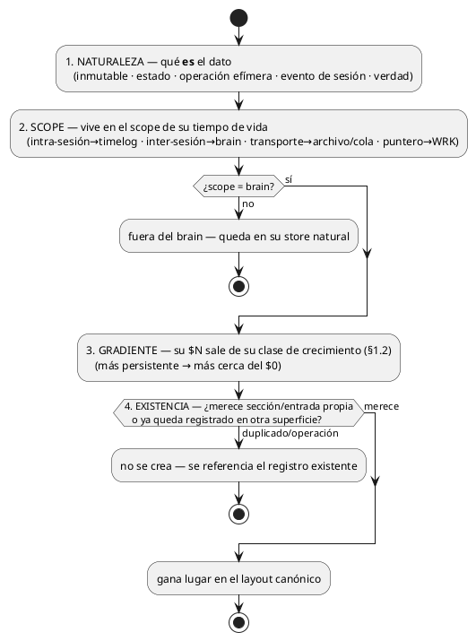

# Canon de Secciones — `brain.cortex` (Nivel 3 / BRAIN)

**Estado:** canon vigente (ALFRED · CYCLE-16 · 2026-11-15, rev. GRADIENT-12)
**Carpeta:** `docs/cortex/` — índice en `README.md`.
**Alcance:** `brain.cortex` de proyecto y `meta-brain.cortex` de workspace.
Identidades (`<agent>.cortex`) y skills tienen canon propio (Nivel 1/2 —
ver `format.md` y `artifacts.md`).
**Directriz del Arquitecto:** las secciones más persistentes y de menor
crecimiento van más cercanas al `$0`; la elevación fluye hacia el cero.

---

## 1. El eje del canon: `$N` = distancia a la verdad

Este canon declara un único eje de ordenamiento:

> **`$N` crece con la volatilidad y la acreción. `$0` es el medio; `$1`..$n
> descienden en persistencia e importancia; el fondo acumula el registro
> apéndice de mayor churn.**

Consecuencias directas:

1. **El número SÍ tiene semántica** — codifica la clase de persistencia de la
   sección. No es "solo orden físico": es el gradiente por el que la
   elevación de aprendizaje se vuelve física (cada promoción es `N`
   decreciente).
2. **El título sigue siendo la identidad** — los consumidores resuelven por
   título, nunca por número hardcodeado. El número puede renumerarse en
   migraciones; el título no.
3. **La numeración es secuencial y sin huecos** desde `$0`.
4. **El archivo se lee como el embudo del aprendizaje**: materia prima en el
   fondo (ledger), destilación en el medio (staging), verdad arriba
   (contract). Leer de `$0` a `$N` es leer de lo permanente a lo efímero.

### 1.1 Por qué converge con la ergonomía de lectura

El gradiente de persistencia y el orden de lectura de bootstrap son el mismo
orden:

- Un agente en bootstrap lee **quién → qué me obliga → qué sé → qué hago →
  dónde quedé**: exactamente las secciones `$1`–`$7`, todas compactas.
- **El muro de eventos no vive en el brain**: los `AUD`/`DEC` son historia
  de sesión y residen en el timelog de su sesión (`$5 EVENTS`, ver `events-timelog.md`). El
  único ledger del brain (`$10 SESSIONS`) es un índice compacto — una
  entrada por sesión.
- Lo durable (`KNOWLEDGE`, `RISKS`) está a la vista antes del estado
  volátil — el agente bootstrappea con su verdad consolidada, no tras ella.
- El glosario abre y la identidad del documento lo sigue de inmediato:
  `ARQX:artifact` es la primera entrada de `$1` — el dato más persistente
  en el punto más cercano al cero.

### 1.2 Clases de crecimiento (la métrica del eje)

La posición se decide por **clase de crecimiento**, no por frecuencia de
mutación puntual:

| Clase | Modelo | ¿Crece? | Ejemplos |
|---|---|---|---|
| `contract` | in-place, casi inmutable | No | IDENTITY, AXIOMS, KNOWLEDGE, RISKS |
| `state` | in-place, reescrito | No (misma entrada) | FOCUS, OBJECTIVES, ACTIVE_CONTEXT, LOOPS |
| `staging` | append con drenaje | Sí, acotada | LESSONS (drena → contract) |
| `ledger` | append-only, acotado | Sí | SESSIONS (índice) — los eventos viven fuera, en timelog |
| `envelope` | estructural | No | GLOSSARY (+ `ARQX:artifact` en cabecera de `$1`) |

Regla derivada: **ninguna sección `ledger` puede preceder a una `staging`,
y ninguna `staging` a una `contract`/`state`.** El embudo es monótono.

### 1.3 Principio de composición — la prueba que todo dato debe pasar

Toda decisión de "¿dónde va esto?" — un dato nuevo, una sección propuesta,
una migración — se resuelve aplicando este procedimiento, **en orden**:

Corolarios — lecciones estructurales que produjeron este canon:

- **Una sección es una clase de contenedor, no un slot por dato.**
  Un registro único no merece sección (`ARQX:artifact` → cabecera de
  `$1`, no `$15`); merece la mejor posición que el formato permita.
- **Estado ≠ operación.** El brain guarda estado y verdad; una
  operación se *audita*, no se *recuerda* (handoff → evento + archivo +
  puntero; la sección `HANDOFFS` empíricamente quedó vacía — era un
  ledger duplicado de un hecho ya registrado).
- **El evento pertenece a su sesión.** Escribir en un store para luego
  inventar una política de borrado (T1 sobre `PULSE`) es deuda
  arquitectónica, no una feature. **Regla: donde exista una política de
  retención/poda, cuestionar el store — no afinar la política.**
- **Sesgo hacia menos secciones.** Cada sección cuesta: esquema,
  validador, posición semántica que defender. Antes de "¿dónde va
  esto?" va "¿merece existir?". Este canon eliminó **cinco** secciones
  (`ARQUX_METADATA`, `HANDOFFS`, `PULSE`, `CONCURRENCY`, `ISSUES`) y
  cada sustracción *añadió* capacidad: evidencia durable, concurrencia
  por archivo, cero poda, cero ledgers duplicados.
- **Descomposición antes que colocación.** Cuando un concepto no
  encaja limpio, descomponerlo (evento / payload / pendiente) y archivar
  cada pieza según su naturaleza — nunca crear una sección para el
  concepto indiferenciado.

---

---

## 2. Layout canónico

| # | Título | Zona | Sigilos | Mutación | Oblig. | Retención |
|---|---|---|---|---|---|---|
| $0 | `GLOSSARY` (sin título visible) | envelope | declaraciones `SIGIL:name{...}`, `format`, `GTYP`, `GMIC`, `GCON` | estructural | Sí | permanente |
| $1 | `IDENTITY` | contract | `IDN`, `ARQX` (con `version`/`revision`/`last_writer`) | in-place | Sí | permanente |
| $2 | `AXIOMS` | contract | `AXM` | in-place | Sí | permanente (mandato) |
| $3 | `KNOWLEDGE` | contract | `KNW`, `REF`, `DEP`, `DESC` | in-place | Opc. | permanente (curado) |
| $4 | `RISKS` | contract | `RSK`, `LIM`, `CNST`, `PFL` | in-place | Opc. | permanente |
| $5 | `FOCUS` | state | `FCS` | in-place | Sí | estado corriente |
| $6 | `OBJECTIVES` | state | `OBJ` | in-place | Sí | estado corriente |
| $7 | `ACTIVE_CONTEXT` | state | `WRK`, `STP`, `NXT`, `CTX`, `HND` | in-place | Sí | estado corriente |
| $8 | `LESSONS` | staging | `LNG` | append+drena | Opc. | **con drenaje** (learning.md §3) |
| $9 | `LOOPS` | system | `LOOP` | in-place | Opc. | estado corriente |
| $10 | `SESSIONS` | ledger | `SES` | append | Opc. | índice de sesiones |

**Sin sección de eventos.** `AUD`/`DEC`/`ERR` son historia *intra*-sesión:
viven en `$5 EVENTS` del timelog de la sesión que los produjo
(`.arqux/timelog/SESNNN_*.cortex`), no en el brain — ver `events-timelog.md`.

**Sin sección de issues.** El store real es `.arqux/issues/`; los
abiertos se derivan por `status` — una sección sería el segundo ledger
del mismo hecho (firma `HANDOFFS`: cero escritores, cero entradas
históricas). Si el bootstrap necesita "qué está roto", es una query o
un puntero en `WRK:current`.

**Sin sección de concurrencia ni de metadata.** `ARQX:artifact` es un
único registro prácticamente inmutable — no merece sección propia: vive
como **primera entrada del cuerpo** (`$1 IDENTITY`, antes de
`IDN:governor`) y porta la revisión del documento
(`version`/`revision`/`last_writer` — el patrón del timelog
`TLG:identity`). Regla
unificada para todo artefacto ArqUX: *el documento se declara a sí mismo
en el punto más cercano al cero que el formato permite* (`$0` es espacio
de declaraciones puras — G016 exige `type:` en todo símbolo del glosario —
así que el primer registro de datos legal es la cabecera de `$1`).
`$0.1`/`$15`/`$19` quedan como posiciones legacy aceptadas en lectura,
jamás emitidas por writers nuevos.

Orden físico = orden de la tabla, `$N` sin huecos ni duplicados.

**Drift real conocido del brain vivo** (residuo del layout viejo —
deuda G-4): `$5 FOCUS` porta 5 `DEC` + ~6 `LNG` arrastradas;
`$3 KNOWLEDGE` aloja un squatter `SES:revision_0_9_0rc1_cierre`;
`$10` = 23 entradas (21 sesiones + 2 `SES:<agent>` fantasma
`status:"active"` de `sessions.py`); `$8` = ~226 `LNG` de las cuales
**183 tienen nombre placeholder `________*` y 22 son boilerplate
`session_*`** — la "cola" opera hoy como almacén (deuda G-5). Y el
propio `$0` del brain **no porta declaraciones ejecutables** (solo
`$0`+`$0:format`) — viola la regla 8; reparación pendiente.

---

---

## 3. Secciones en detalle

### $0 GLOSSARY — el medio (envelope)

Único contenido estructural. PROHIBIDO contener memoria operativa (E033).
Viven aquí: `$0:format{cortex:1.0, encoding:UTF-8}`, declaraciones
ejecutables `SIGIL:name{type, weight, focus, fields, desc, open}`, tipos
(`GTYP`), micro-glosario (`GMIC`) y constantes (`GCON`).

- **Lectores:** parser, validator, writer.
- **Escritores:** writer (auto-declara sigilos emitidos), migrator.
- **Regla:** toda escritura nueva declara — `$0:format` + declaraciones
  ejecutables obligatorias.

### $1 IDENTITY — quién es este brain (contract)

`ARQX:artifact{level:3, name, usage, kind, version, revision, last_writer}`
como **primera entrada** — la identidad del *documento*, incluida su
revisión (el patrón `TLG:identity` del timelog: `version`/`revision` en
la propia identidad) — seguida de `IDN:governor` (obligatorio en brain
de proyecto) — la identidad del *agente/proyecto*. Mismo patrón que los
archivos de identidad (`<agent>.cortex`): el documento se declara a sí
mismo antes de declarar su contenido.

- **Lectores:** bootstrap, `identity.*`, verify, `project.status`.
- **Escritores:** `project.init`, `protocol.*`.
- **Crecimiento:** nulo — 2-3 entradas, reescritas a lo sumo.

### $2 AXIOMS — la constitución del proyecto (contract)

Axiomas de comportamiento **del proyecto**: reglas non-negotiable
impuestas por el Arquitecto o **elevadas por aprendizaje forzado**
(corrección repetida → `AXM`). Recomendado `survive:min` o
`severity:blocking` para que la mutabilidad del brain no los degrade.

- Distinto de `AGENTS.md` (axiomas transversales del framework, kernel) y
  de los axiomas de identidad (contrato del agente): estos son la
  constitución **del proyecto** — hacen único a cada brain.
- **Lectores:** todo agente en bootstrap — se leen antes que el estado.
- **Escritores:** mandato del Arquitecto, elevación forzada del motor.
- **Crecimiento:** nulo por diseño — cada axioma pesa una decisión.

### $3 KNOWLEDGE — verdad operacional durable (contract)

Conocimiento consolidado del proyecto: patrones verificados, decisiones
técnicas, lecciones promovidas. Es la **primera parada de elevación** del
embudo (`LNG` → `KNW`).

- Sigilos: `KNW` (hecho durable), `REF` (referencia), `DEP`
  (dependencia), `DESC` (descriptor).
- **Lectores:** bootstrap de contexto, `cortex.knowledge`, planning.
- **Escritores:** `cortex.learn.elevate` (con confirmación), el Arquitecto.
- **Crecimiento:** lento y curado — cada entrada es una verdad, no un
  evento. Si crece rápido, algo está escapando del filtro.

### $4 RISKS — los límites del dominio (contract)

`RSK` (riesgos), `LIM` (límites duros), `CNST` (restricciones), `PFL`
(pitfalls). Conocimiento sobre lo que puede dañar — adyacente a
`KNOWLEDGE` por naturaleza (es verdad sobre fronteras).

- **Lectores:** verify, planning, auditoría.
- **Crecimiento:** nulo-lento; entradas estables.

### $5 FOCUS — qué ahora (state)

`FCS` — el foco corriente del trabajo. Regla Nivel 3 (E024/E034): ≥1 `FCS`
con `status∈{current,blocked}` y `what` no vacío. `status:done` no cuenta
como activo.

- **Mutación:** in-place — se reescribe el foco, no se acumula historia
  de focos (eso es PULSE/SESSIONS).
- **Lectores:** bootstrap dashboard, verify E024.

### $6 OBJECTIVES — hacia dónde (state)

`OBJ` — objetivos activos. Misma regla Nivel 3: ≥1 `OBJ` con
`status∈{current,blocked}` y `goal` no vacío.

- **Mutación:** in-place o reemplazo dirigido; los objetivos cumplidos
  cambian de status, no se coleccionan aquí.

### $7 ACTIVE_CONTEXT — memoria de trabajo (state)

`WRK:current` es la **single source of truth** del estado de trabajo del
agente (bootstrap lo lee primero tras el contrato). `STP`/`NXT` portan
próximos pasos; `CTX` contexto activo. `HND:<to>` porta el payload de
un handoff pendiente (estado, no operación — ver nota HANDOFFS en
`$10`).

- **Mutación (canon):** máxima frecuencia, **cero crecimiento** — cada
  checkpoint reescribe `WRK:current` in-place. Esperado 1-3 entradas +
  los 5 `HND` residuales G-8b; si acumula, el writer está fallando.
- **Residuo huérfano**: las 5 `HND:*` migradas en G-8b eran residuo sin
  consumidor — `session.handoff` ya escribe `HND:<to>` en esta sección
  por título (CYCLE-16) y `handoffs/` no se recrea. Los `HND` migrados
  drenan cuando su handoff se claimea o expira.
- **Colisiones posicionales** (cerradas en CYCLE-16): `pulse.py` enruta
  `AUD` al timelog `$5 EVENTS` con fallback PULSE *por título*;
  `cortex.checkpoint` escribe `WRK:current` resolviendo `ACTIVE_CONTEXT`
  por título (fallback `$7`, sin sección fantasma); `sessions.py`
  resuelve `SESSIONS`/`ACTIVE_CONTEXT`/`$1 ARQX` por título — los
  escritores `$5`/`$6`/`$12` posicionales fueron retirados.
- **Posición:** última de la zona `state` — el estado más volátil antes
  de las colas.

### $8 LESSONS — la bisagra del embudo (staging)

**Única superficie de lecciones del workspace** (regla del Arquitecto
2026-11-15): toda captura — `identity.record` (cualquier kind),
consolidaciones (`cycle.close`, `pulse.*`) — escribe `LNG` aquí, con
`type/cause/lesson/prevention/agent`.

- **Posición:** única sección de `staging`, inmediatamente tras el
  estado — es la bisagra entre las fuentes de abajo y el contrato de
  arriba.
- **Drenaje (obligatorio):** `$8` es una **cola, no un almacén**. Las
  lecciones drenan hacia: `$3 KNW` (conocimiento operativo,
  `cortex.learn.elevate`), `$2 AXM` (aprendizaje forzado), o
  `<agent>.cortex` `AXM`/`LIM` (conductual, `identity.elevate`). Una
  lección que no drena en su horizonte de revisión es deuda.
- `.lessons.cortex` y `BEHAVIORAL LESSONS` de identidades están
  deprecados como almacenes — la identidad solo porta contratos elevados.
- **Retención:** política de drenaje definida en learning.md §3 (evolución
  documentada — análoga a T1 de PULSE).

### $9 LOOPS — autonomía registrada (system)

Declaraciones `LOOP:<name>{state,index,phases,recurrence,max_stall}` de
loops autónomos — entidades vivas cross-sesión (config + estado
in-place). El skill `autonomia` los gobierna; el trail de ejecución
vive en el timelog.

> **Nota — por qué no existe `ISSUES`:** el store real es
> `.arqux/issues/` (un archivo por issue) y los abiertos se derivan por
> `status` — cero escritores, cero entradas históricas: firma
> `HANDOFFS`. Un issue abierto sí es estado inter-sesión, pero se
> responde con una query o un puntero `WRK`, no con un segundo ledger.

> **Nota — por qué no existe `CONCURRENCY`:** su única entrada era
> `ERR:concurrency{version,last_writer}` — ni concurrencia ni errores,
> sino **revisión del documento**: metadata que ahora vive en
> `ARQX:artifact` (`$1`). Los errores como eventos viven en timelog
> `$5 EVENTS`.

### $10 SESSIONS — registro de sesiones (ledger)

`SES` — una entrada por sesión (registro compacto; la trazabilidad
detallada vive en `.arqux/timelog/`). Append-only, crecimiento moderado.
Es **fuente primaria de señal** para el motor de aprendizaje.

> **Nota — por qué no existe `HANDOFFS`:** un handoff es una *operación*,
> no un estado. Se descompone en evento (→ `$5 EVENTS` del timelog del
> emisor), payload (→ `HND:<to>` en `$7` — el directorio `handoffs/`
> fue eliminado en G-8b; el archivo-cola era un segundo mensajero del
> mismo estado) y pendiente (derivable de la presencia de la entrada
> `HND`). La sección empíricamente quedó vacía.

> **Nota — por qué no existe `PULSE`:** un evento es historia *intra*-
> sesión, no estado del proyecto. La sección fue la de mayor churn del
> brain (276 entradas archivadas) y requirió una ventana de retención (T1) para
> deshacerse de lo que escribía — la prueba de que nunca perteneció
> aquí. Bajo este canon los eventos viven en `$5 EVENTS` del timelog de
> su sesión (`events-timelog.md`): append-only, **nunca podados**, con su contexto
> completo. El brain conserva solo el índice `SES`.

---

---

## 4. Reglas de orden y escritura

1. **Ordinal estricto** — las secciones se emiten en el orden de la
   tabla; `$N` sin huecos ni duplicados.
2. **Zonas monótonas** — `contract` < `state` < `staging` < `system` <
   `ledger`. `$0` abre el envelope y `$1` porta la identidad del
   documento; no existe sección colofón. Una sección nueva se ubica por
   su clase de crecimiento, no por conveniencia de numeración.
3. **Título canónico exacto** — mayúsculas; guion bajo solo donde la
   tabla lo indica (`ACTIVE_CONTEXT`). El validador `brain_structure`
   compara id↔título contra esta tabla (GRADIENT-12, `constants.py`
   `BRAIN_SECTION_TITLES`) desde CYCLE-16 — un brain legacy `$0`–`$15`
   reporta `E027_MALFORMED_SECTION` por posición, como corresponde.
4. **Secciones opcionales ausentes** — permitido omitir una opcional
   vacía; warning, no error.
5. **Extensiones** — una sección nueva entra como `$11+` con título
   propio y DEBE registrarse aquí (con su zona) antes de usarse en
   producción.
6. **Resolución por título** — todo consumidor nuevo resuelve por
   título (`learning/sections.py` lo hace), nunca por número.
7. **Crecimiento acotado** — el brain acumula axiomas, conocimiento y
   **punteros**, no bitácoras ni eventos. Trazabilidad → SESSIONS;
   eventos → timelog `$5 EVENTS` (ver `events-timelog.md`). LESSONS drena. Ningún agente debe
   leer ~700KB para bootstrap.
8. **Toda escritura nueva declara** — `$0:format` + declaraciones
   ejecutables de los sigilos emitidos + `ARQX:artifact` como primera
   entrada del cuerpo. El writer las genera automáticamente; los writers
   hand-rolled deben replicarlas.

---

---

## 5. Mapa sigilo → sección (motor de aprendizaje)

| Sigilo | Sección | Título | Zona |
|---|---|---|---|
| `IDN` | $1 | IDENTITY | contract |
| `AXM` | $2 | AXIOMS | contract |
| `KNW`, `REF`, `DEP`, `DESC` | $3 | KNOWLEDGE | contract |
| `RSK`, `LIM`, `CNST`, `PFL` | $4 | RISKS | contract |
| `FCS` | $5 | FOCUS | state |
| `OBJ` | $6 | OBJECTIVES | state |
| `WRK`, `STP`, `NXT`, `CTX`, `HND` | $7 | ACTIVE_CONTEXT | state |
| `LNG` | $8 | LESSONS | staging |
| `LOOP` | $9 | LOOPS | system |
| `SES` | $10 | SESSIONS | ledger |
| `AUD`, `DEC`, `ERR` | — | **timelog `$5 EVENTS`** () | intra-sesión |
| `ARQX`, `SKL` | $1 | IDENTITY (primera entrada) | contract |

**Elevación forzada → AXIOMS:** cuando el aprendizaje detecta una
corrección repetida o una regla de comportamiento del proyecto, eleva a
`AXM` en `$2` — las lecciones informan, los axiomas mandan. Es el salto
más largo del embudo (staging → apex) y el más escaso por diseño.

---
