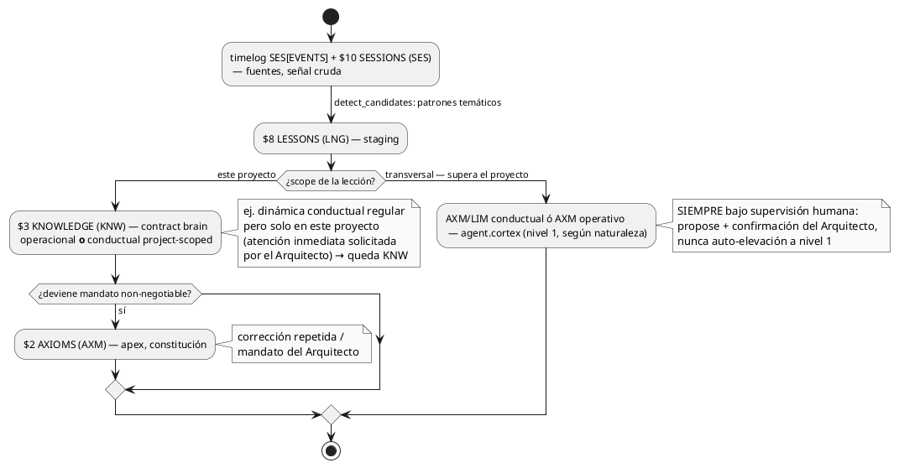
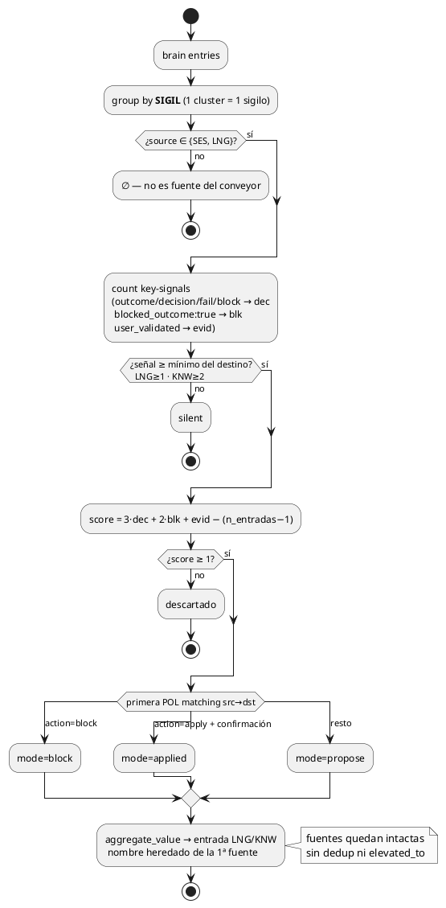
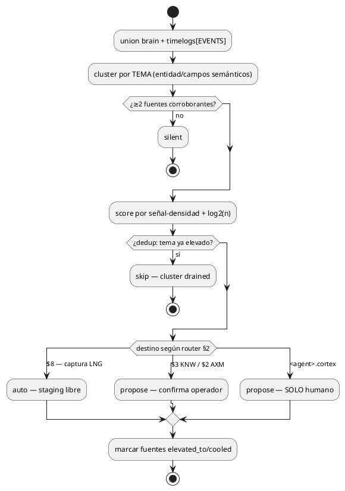

# Motor de Aprendizaje — fuentes, candidatos, router y dinámica

**Estado:** canon vigente + propuesta pendiente de directriz (ALFRED ·
CYCLE-16 · 2026-11-15).
**Carpeta:** `docs/cortex/` — este documento responde *"¿cómo aprende el
sistema?"*. La estructura del brain en `brain-canon.md`; los eventos en
`events-timelog.md`.

---

## 1. El embudo de aprendizaje

### 2 Flujo canónico — router por naturaleza × scope

Desde `$8 LESSONS` una lección tiene **destinos paralelos, no una
cadena**: la compuerta es la **naturaleza** de la lección (operacional /
conductual) cruzada con su **scope** (este proyecto / transversal).
`AXM` del proyecto NO es la puerta de la identidad — son destinos
hermanos alcanzables directamente desde `$8`.



Reglas del router:

| Naturaleza \ Scope | Este proyecto | Transversal |
|---|---|---|
| **Operacional** | `$3 KNW` (brain) | `AXM` operativo → `<agent>.cortex` *(supervisado)* |
| **Conductual** | `$3 KNW` (brain) | `AXM`/`LIM` → `<agent>.cortex` *(supervisado)* |

- **El scope decide si sale del proyecto; la naturaleza decide el
  sigilo destino** (el contrato del artefacto que la recibe: `KNW` en
  brain, `AXM`/`LIM` en identidad).
- **`$2 AXIOMS` no es paso intermedio** — es la graduación de un `KNW`
  que deviene mandato, o inserción directa del Arquitecto.
- **Toda proyección a identidad es `propose` + confirmación humana** —
  el motor nunca auto-eleva a nivel 1.
- Dentro del brain, la promoción sigue siendo `N` decreciente
  (`$8→$3→$2`); la vía identidad es una **salida horizontal** — sale
  del brain, no sube en `$N`.

### 3 Drenaje de `$8` (política declarada — pendiente de dinámica)

`$8` es cola: una `LNG` tiene tres salidas legítimas — promoción
(`KNW`/`AXM`/identidad), consolidación (compactación temática), o
enfriamiento (decaimiento documentado). La dinámica exacta (umbrales,
ventana, dedup contra lecciones existentes) se define con la especificación
del algoritmo — **pendiente de la directriz del Arquitecto**.

### 4 Señal y candidato (redefinición pendiente)

El detector actual agrupa por sigilo (todo `SES` = 1 cluster) y el score
penaliza el tamaño (`score − (n−1)`) — lo que invierte la intuición (más
evidencia, peor score) y cierra estructuralmente el drenaje `$8→$3`.
Bajo este canon, un **candidato** se redefine como: *un patrón temático
repetido con evidencia corroborante y sin lección equivalente ya
registrada*. La dinámica de scoring/clustering se define con la
especificación del algoritmo — **pendiente de la directriz del
Arquitecto**.

### 5 El motor tal como funciona hoy (estado real, 2026-11-15)

Implementación: `core/learning/algorithms/{candidates,scoring,policy}.py`
+ `elevation/{plan,aggregate}.py`. Flujo exacto:

**1. Clustering** — `detect_candidates` agrupa **todas** las entradas del
brain por sigilo completo: un cluster = un sigilo. Solo dos fuentes
existen (`_TARGET_BY_SOURCE`, candidates.py:62): `SES→LNG` y
`LNG→KNW`. Los `AUD`/`DEC` (eventos, hoy en `$7`) **no son fuente**.
Nota: `POL:candidate_detection` declara
`scan_sigils:"WRK|SES|LNG|RSK|NXT|CLAIM|LIM"` — el código no la lee;
la fuente real es la tabla hardcodeada.

**2. Conteo de señal** — por cluster se cuentan **claves de campos**:
`outcome`/`decision`/`fail`/cualquier clave con `"decision"` o `"block"`
→ `decisions`; `blocked_outcome:true` → `blocked`; `user_validated`
verdadero → `evidence`. `hints` es siempre 0. Los campos que de verdad
portan lección (`lesson`, `cause`, `fix`, `prevention`, `evidence_ref`)
**valen cero** — el motor no distingue contenido, solo presencia de
claves. **Defecto real** (candidates.py:138): `bool(value_item)` —
`user_validated:"false"` (string) evalúa verdadero; el conteo es laxo
en `detect_candidates` aunque `_count_signals` (:102) sea estricto.

**3. Puertas mínimas** — un `LNG` solitario sin señal se silencia (no es
patrón); si hay cluster sin señal se sintetiza `decisions=min(3,n)`. El
mínimo por destino: `LNG`≥1 señal, `KNW`≥2.

**4. Score** — `3·dec + 2·blocked + hints + evidence − (n_entradas−1)`.
La penalización de "edad" **es el tamaño del cluster**: a más evidencia
acumulada, peor score. Efecto medido en el brain real: cluster `SES`
(~24 entradas, ~45 `outcome`) → **112** (P0); cluster `LNG` (**233
entradas** totales — 227 en `$8` + 6 fuera, 3 decisions sintéticos) →
**−223** → descartado. El drenaje `$8→$3` está cerrado por aritmética,
no por política.

**5. Política (gate)** — `plan_patch` (elevation/plan.py) opera así:

- **Protección = fuente, no destino** (`_PROTECTED_SIGILS`
  `plan.py:11`; helper `:26-34`; call-site `:59`): `CNST,IDN,AXM,CLAIM,LIM`
  — si el **sigilo fuente** del candidato es protegido (`CNST` solo
  con `severity:"blocking"`), el patch nace `mode:"block"`. Como las
  fuentes son solo `SES`/`LNG`, la protección nunca se dispara en la
  práctica.
- Luego la **primera** regla `POL` que casa `source→target`:
  `action:block` → `block`; `requires:"admin_policy"` → `apply` solo si
  `admin_confirmed`; `action:"apply"` → `apply` solo con confirmación;
  resto → `propose`.
- **Fallback no documentado** (:114): si ninguna regla casa pero
  **existe cualquier** regla `action:"block"` en el set → `block`.
  El match corre antes, así que `LNG→KNW` sí alcanza
  `POL:auto_lng_to_knw`; el fallback solo atrapa pares sin regla.
- `plan_patch` no consume `protected_targets`/`PRT` parseados — usa su
  propio `_PROTECTED_SIGILS` hardcodeado. Y el `PRT` del archivo ni
  siquiera parsea: `parse_policy_document` lee `sigils|targets|
  protected`, pero `PRT:critical_sigils` usa `items:` → ignorado
  (cae al default, que coincide por casualidad).

**6. Materialización** — `aggregate_value` fusiona campos y produce la
lección (`lesson:"Recurring pattern across N sessions: <outcomes>"` +
`evidence_ref` con las fuentes); el nombre hereda el de la **primera**
entrada fuente. Las fuentes quedan intactas (no se consumen) y
`candidate_id` es un hash determinista de los nombres → **el mismo
cluster re-candidatura en cada corrida** (sin dedup ni `elevated_to`).

**7. Entrypoint real** — `elevate_candidate`
(`core/learning/_elevate.py:123-207`) envuelve `plan_patch` con:
`dry_run` + `confirm_hash` (la confirmación exige el hash del plan),
validación **anti-boilerplate** (`:44-71` — rechaza lecciones que
repiten el outcome literal, la causa del bloqueo
`POL:block_ses_to_lng`), y escritura gobernada
`_apply_patch_governed` (`:85-120`).

**Diagrama de decisión actual:**



**Config declarada pero inerte** en este camino: `THR` umbrales,
serie `fibonacci`, `cooling` (3 sesiones), `detection.min_cluster_size`,
`feedback`, `protected_patterns` — se parsean (`policy.py`) sin efecto.
`MIN_SESSIONS_FOR_LNG` y `MAX_CANDIDATES` son constantes codeadas.

**Brechas declaradas** (alineación pendiente — G-5 (ver `migration.md`)): clustering por
sigilo ≠ patrón temático; score castiga evidencia acumulada; campos
semánticos ignorados; fuentes limitadas a `SES`/`LNG`; sin dedup ni
consumo; nombre heredado débil; `user_validated` laxo
(`bool("false")`=True); `PRT` no parsea `items:`; `plan_patch` ignora
política parseada y usa lista propia; `plan_patch` fallback
posicional `or "$9"` (`plan.py:55`) = LOOPS bajo canon nuevo — si la
resolución por título falla, el patch aterriza en la sección
equivocada (G-2). `POL:block_ses_to_lng` **está vivo e intencional**
(instalado 2026-11-15 contra boilerplate de `aggregate_value`;
`lift_when:"aggregation fix shipped"`) — no es política stale: es la
compuerta activa.

### 6 El motor esperado — propuesta de dinámica (a validar)

**Estado: propuesta Alfred pendiente de la directriz del Arquitecto.**
Bajo el router §2 y las fuentes `events-timelog.md`, la máquina destino:

**6.1 Fuentes** — `timelog[*].$5 EVENTS` (AUD/DEC/ERR) + `$10 SES` +
`$8 LNG`. El documento de aprendizaje es la **unión** brain + timelogs
del proyecto (enumerables, cacheables por `revision`).

**6.2 Clustering temático** (sustituye a "1 cluster = 1 sigilo") —
una clave de tema extraída del **contenido**, no del tipo:

- Entidad referenciada: `BLP-NNN`, `T-NNN`, `E-NNNN`, `issue-*`,
  handler, path.
- Campo semántico compartido: mismo `cause`, mismo `type`, mismos
  tópicos de `lesson`/`topic`.
- Un cluster = entradas del mismo tema con **≥2 fuentes corroborantes**
  (≥2 sesiones distintas para cualquier claim de recurrencia).

**6.3 Score por señal-densidad** (sustituye al castigo de tamaño) —
la evidencia acumulada **ayuda con rendimiento decreciente**, nunca
resta:

```
score = 3·decisions + 2·blocked + 2·correcciones_arquitecto
      + 1·user_validated + 1·campos_semánticos_presentes
      + ⌊log2(n_corroborantes)⌋            ← más evidencia suma, no resta
```

`campos_semánticos` = presencia real de `lesson`/`cause`/`fix`/
`prevention`/`evidence_ref` — el motor por fin lee contenido, no solo
claves. Corrección explícita del Arquitecto es la señal más pesada tras
las decisiones: es un patrón conductual forzado.

**6.4 Modos** — inalterados en forma, ajustados en scope:

| Modo | Aplica a | Regla |
|---|---|---|
| `auto` | registrar `LNG` en `$8` desde fuentes | staging es barato — captura libre |
| `propose` | `LNG→KNW`, `LNG→AXM`($2), consolidación | siempre con confirmación |
| `propose` **fuerte** | cualquier proyección a `<agent>.cortex` | **solo confirmación humana** — nunca `apply` |
| `block` | destinos protegidos, políticas activas | primer match gana |

**6.5 Drenaje de `$8`** — `LNG` tiene horizonte de revisión = `cooling.sessions` (3 por defecto). Salidas:

1. **Elevación** → `KNW`/`AXM`/identidad (con `elevated_to` en la fuente).
2. **Consolidación** → se funde en una `LNG`/`KNW` existente (dedup por
   similitud de tema, no por nombre).
3. **Enfriamiento** → superado el horizonte sin elevación: se anota
   `status:"cooled"` y se compacta — una `LNG` enfriada puede archivarse
   al timelog de su sesión origen (append-only, cero pérdida).

Una `LNG` marcada `elevated_to`/`cooled` **sale del universo de
candidatos** — el dedup es por estado, no por hash de nombres.

**6.6 Perillas** — las que hoy parsean sin efecto ganan su rol:

| Perilla (llaves reales del corpus) | Rol asignado |
|---|---|
| `THR` + `fibonacci_thresholds` | bandas de corroboración: 2=repeated, 3=pattern, 5=candidate, 8=strong, 13=critical (para auto-LNG de alto volumen) |
| `cooling` (`half_life_days`, `min_score_to_survive`) | horizonte de drenaje de `$8` (§6.5) |
| `detection` (`same_sigil_in_window`, `window_hours`, `cross_session`) | mínimo de fuentes corroborantes + ventana |
| `feedback` | registrar aceptación/rechazo de propuestas (afina scoring futuro) |
| `protected_patterns` | temas que nunca auto-elevan |
| `POL` | gates por `source→target` + condición (`when`) |

**6.7 Activación — frontera asimétrica** — el motor NO corre al
cierre; corre donde hay un humano. El cierre de sesión es barato por
ley (ficha `SES` + watermark `learn.last_processed`, cero detección):
un close pesado impone espera cuando el operador ya se fue, y toda
propuesta generada ahí aterriza sin decisor. La **apertura**
(`session.open` / bootstrap, `AXM:brain_first` ya lee el brain) es el
momento natural: detección sobre el **delta** desde `last_processed`,
sweep de `$8`, y las propuestas salen en el dashboard de arranque —
con el humano sentado y atento. La cola (`$8`, timelog) absorbe la
deferencia sin pérdida: nada exige procesar al cerrar. La
auto-captura a `$8` corre en el mismo open, o incrementalmente por
evento si resulta trivial.

```plantuml
@startuml
skinparam monochrome true
|en sesión|
:eventos → timelog[$5 EVENTS]
 (incremental, coste ~0);
|close|
:ficha SES + watermark last_processed
 — barato por ley, cero detección;
|open / bootstrap|
:detección sobre DELTA (desde watermark);
:sweep $8 (cooled/elevated_to);
:propuestas → dashboard de arranque;
note right
  el humano está presente:
  aquí se decide, aquí se eleva
end note
@enduml
```

Regla general: **todo lo que requiere un humano ocurre donde hay uno;
todo lo mecánico quedó incremental durante la sesión.**

**Diagrama de decisión destino:**



---
