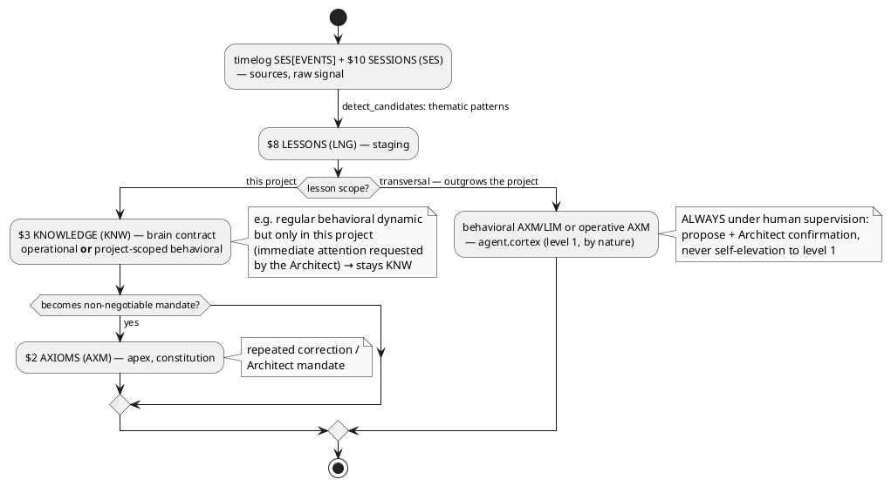
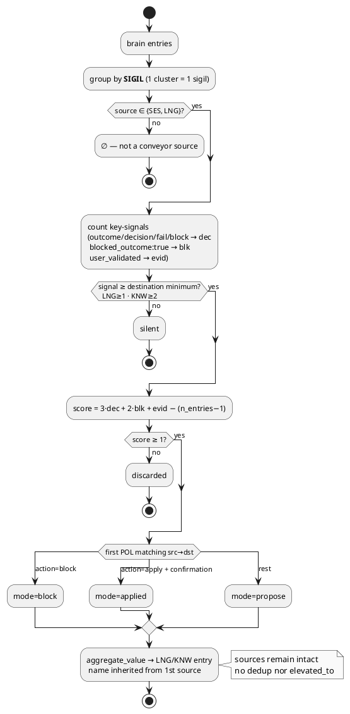
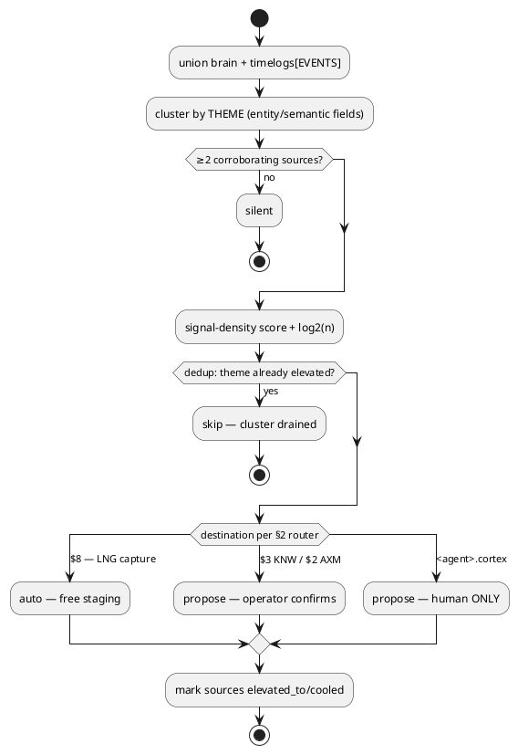

<!-- DOC-BRAND -->
<p align="center">
  <picture>
    <source media="(prefers-color-scheme: dark)" srcset="../../../docs/assets/brand/arqux-logo-primary-dark.svg">
    
  </picture>
</p>
<p align="center"><sub>Canon · Normative · ArqUX 1.0.0</sub></p>
<!-- /DOC-BRAND -->

# Learning Engine — sources, candidates, router and dynamics

*English translation — canonical source: `docs/es/especificacion/aprendizaje.md`*

**Status:** current canon + proposal pending directive (ALFRED ·
CYCLE-16 · 2026-11-15).
**Folder:** `docs/es/especificacion/` — this document answers *"how
does the system learn?"*. Brain structure in `cerebro-canon.md`;
events in `eventos-timelog.md`.

---

## 1. The learning funnel

### 2 Canonical flow — router by nature × scope

From `$8 LESSONS` a lesson has **parallel destinations, not a
chain**: the gate is the lesson's **nature** (operational /
behavioral) crossed with its **scope** (this project / transversal).
The project's `AXM` is NOT the identity's door — they are sibling
destinations reachable directly from `$8`.



Router rules:

| Nature \ Scope | This project | Transversal |
|---|---|---|
| **Operational** | `$3 KNW` (brain) | operative `AXM` → `<agent>.cortex` *(supervised)* |
| **Behavioral** | `$3 KNW` (brain) | `AXM`/`LIM` → `<agent>.cortex` *(supervised)* |

- **Scope decides whether it leaves the project; nature decides the
  destination sigil** (the contract of the receiving artifact: `KNW`
  in brain, `AXM`/`LIM` in identity).
- **`$2 AXIOMS` is not an intermediate step** — it is the graduation
  of a `KNW` that becomes a mandate, or direct Architect insertion.
- **Every projection to identity is `propose` + human confirmation** —
  the engine never self-elevates to level 1.
- Inside the brain, promotion still follows decreasing `N`
  (`$8→$3→$2`); the identity path is a **horizontal exit** — it
  leaves the brain, it does not climb `$N`.

### 3 `$8` drainage (declared policy — dynamics pending)

`$8` is a queue: an `LNG` has three legitimate exits — promotion
(`KNW`/`AXM`/identity), consolidation (thematic compaction), or
cooling (documented decay). The exact dynamics (thresholds,
window, dedup against existing lessons) is defined with the
algorithm specification — **pending the Architect's directive**.

### 4 Signal and candidate (redefinition pending)

The current detector groups by sigil (every `SES` = 1 cluster) and
the score penalizes size (`score − (n−1)`) — which inverts intuition
(more evidence, worse score) and structurally closes the `$8→$3`
drain. Under this canon, a **candidate** is redefined as: *a repeated
thematic pattern with corroborating evidence and no equivalent
lesson already recorded*. The scoring/clustering dynamics is defined
with the algorithm specification — **pending the Architect's
directive**.

### 5 The engine as it works today (real state, 2026-11-15)

Implementation: `core/learning/algorithms/{candidates,scoring,policy}.py`
+ `elevation/{plan,aggregate}.py`. Exact flow:

**1. Clustering** — `detect_candidates` groups **all** brain entries
by full sigil: one cluster = one sigil. Only two sources exist
(`_TARGET_BY_SOURCE`, candidates.py:62): `SES→LNG` and
`LNG→KNW`. `AUD`/`DEC` (events, today in `$7`) **are not sources**.
Note: `POL:candidate_detection` declares
`scan_sigils:"WRK|SES|LNG|RSK|NXT|CLAIM|LIM"` — the code does not
read it; the real source is the hardcoded table.

**2. Signal counting** — per cluster, **field keys** are counted:
`outcome`/`decision`/`fail`/any key with `"decision"` or `"block"`
→ `decisions`; `blocked_outcome:true` → `blocked`; `user_validated`
truthy → `evidence`. `hints` is always 0. The fields that actually
carry lesson (`lesson`, `cause`, `fix`, `prevention`, `evidence_ref`)
**score zero** — the engine does not distinguish content, only key
presence. **Real defect** (candidates.py:138): `bool(value_item)` —
`user_validated:"false"` (string) evaluates true; counting is lax
in `detect_candidates` even though `_count_signals` (:102) is strict.

**3. Minimum gates** — a lone `LNG` without signal is silenced (not
a pattern); if there is a signal-less cluster, `decisions=min(3,n)`
is synthesized. Per-destination minimum: `LNG`≥1 signal, `KNW`≥2.

**4. Score** — `3·dec + 2·blocked + hints + evidence − (n_entries−1)`.
The "age" penalty **is the cluster size**: the more accumulated
evidence, the worse the score. Measured effect on the real brain:
`SES` cluster (~24 entries, ~45 `outcome`) → **112** (P0); `LNG`
cluster (**233 total entries** — 227 in `$8` + 6 outside, 3
synthetic decisions) → **−223** → discarded. The `$8→$3` drain is
closed by arithmetic, not policy.

**5. Policy (gate)** — `plan_patch` (elevation/plan.py) operates as:

- **Protection = source, not destination** (`_PROTECTED_SIGILS`
  `plan.py:11`; helper `:26-34`; call-site `:59`): `CNST,IDN,AXM,CLAIM,LIM`
  — if the candidate's **source sigil** is protected (`CNST` only
  with `severity:"blocking"`), the patch is born `mode:"block"`.
  Since sources are only `SES`/`LNG`, protection never fires in
  practice.
- Then the **first** `POL` rule matching `source→target`:
  `action:block` → `block`; `requires:"admin_policy"` → `apply` only
  if `admin_confirmed`; `action:"apply"` → `apply` only with
  confirmation; rest → `propose`.
- **Undocumented fallback** (:114): if no rule matches but
  **any** `action:"block"` rule exists in the set → `block`.
  Matching runs first, so `LNG→KNW` does reach
  `POL:auto_lng_to_knw`; the fallback only catches rule-less pairs.
- `plan_patch` does not consume parsed `protected_targets`/`PRT` —
  it uses its own hardcoded `_PROTECTED_SIGILS`. And the file's `PRT`
  does not even parse: `parse_policy_document` reads `sigils|targets|
  protected`, but `PRT:critical_sigils` uses `items:` → ignored
  (falls to the default, which coincidentally matches).

**6. Materialization** — `aggregate_value` merges fields and produces
the lesson (`lesson:"Recurring pattern across N sessions: <outcomes>"`
+ `evidence_ref` with the sources); the name inherits from the
**first** source entry. Sources remain intact (not consumed) and
`candidate_id` is a deterministic hash of the names → **the same
cluster re-candidatures on every run** (no dedup nor `elevated_to`).

**7. Real entrypoint** — `elevate_candidate`
(`core/learning/_elevate.py:123-207`) wraps `plan_patch` with:
`dry_run` + `confirm_hash` (confirmation requires the plan's hash),
**anti-boilerplate** validation (`:44-71` — rejects lessons that
repeat the literal outcome, the cause of the `POL:block_ses_to_lng`
block), and governed write `_apply_patch_governed` (`:85-120`).

**Current decision diagram:**



**Config declared but inert** on this path: `THR` thresholds,
`fibonacci` series, `cooling` (3 sessions), `detection.min_cluster_size`,
`feedback`, `protected_patterns` — they parse (`policy.py`) without
effect. `MIN_SESSIONS_FOR_LNG` and `MAX_CANDIDATES` are hardcoded
constants.

**Declared gaps** (alignment pending — G-5 (see `migracion.md`)):
clustering by sigil ≠ thematic pattern; score punishes accumulated
evidence; semantic fields ignored; sources limited to `SES`/`LNG`;
no dedup nor consumption; weak inherited name; lax `user_validated`
(`bool("false")`=True); `PRT` does not parse `items:`; `plan_patch`
ignores parsed policy and uses its own list; `plan_patch` positional
fallback `or "$9"` (`plan.py:55`) = LOOPS under new canon — if title
resolution fails, the patch lands in the wrong section (G-2).
`POL:block_ses_to_lng` **is alive and intentional** (installed
2026-11-15 against `aggregate_value` boilerplate;
`lift_when:"aggregation fix shipped"`) — not a stale policy: it is
the active gate.

### 6 The expected engine — dynamics proposal (to validate)

**Status: Alfred's proposal pending the Architect's directive.**
Under the §2 router and the `eventos-timelog.md` sources, the
destination machine:

**6.1 Sources** — `timelog[*].$5 EVENTS` (AUD/DEC/ERR) + `$10 SES` +
`$8 LNG`. The learning document is the **union** of brain + project
timelogs (enumerable, cacheable by `revision`).

**6.2 Thematic clustering** (replaces "1 cluster = 1 sigil") —
a theme key extracted from **content**, not type:

- Referenced entity: `BLP-NNN`, `T-NNN`, `E-NNNN`, `issue-*`,
  handler, path.
- Shared semantic field: same `cause`, same `type`, same
  `lesson`/`topic` topics.
- A cluster = same-theme entries with **≥2 corroborating sources**
  (≥2 distinct sessions for any recurrence claim).

**6.3 Signal-density score** (replaces the size penalty) —
accumulated evidence **helps with diminishing returns**, never
subtracts:

```
score = 3·decisions + 2·blocked + 2·architect_corrections
      + 1·user_validated + 1·semantic_fields_present
      + ⌊log2(n_corroborators)⌋           ← more evidence adds, never subtracts
```

`semantic_fields` = real presence of `lesson`/`cause`/`fix`/
`prevention`/`evidence_ref` — the engine finally reads content, not
just keys. Explicit Architect correction is the heaviest signal after
decisions: it is a forced behavioral pattern.

**6.4 Modes** — unchanged in form, adjusted in scope:

| Mode | Applies to | Rule |
|---|---|---|
| `auto` | registering `LNG` in `$8` from sources | staging is cheap — free capture |
| `propose` | `LNG→KNW`, `LNG→AXM`($2), consolidation | always with confirmation |
| `propose` **strong** | any projection to `<agent>.cortex` | **human confirmation only** — never `apply` |
| `block` | protected destinations, active policies | first match wins |

**6.5 `$8` drainage** — `LNG` has a review horizon = `cooling.sessions` (3 by default). Exits:

1. **Elevation** → `KNW`/`AXM`/identity (with `elevated_to` on the
   source).
2. **Consolidation** → merges into an existing `LNG`/`KNW` (dedup by
   theme similarity, not name).
3. **Cooling** → horizon passed without elevation: `status:"cooled"`
   is noted and compacted — a cooled `LNG` may be archived to its
   origin session's timelog (append-only, zero loss).

An `LNG` marked `elevated_to`/`cooled` **leaves the candidate
universe** — dedup is by state, not name hash.

**6.6 Knobs** — the ones that today parse without effect gain their
role:

| Knob (real corpus keys) | Assigned role |
|---|---|
| `THR` + `fibonacci_thresholds` | corroboration bands: 2=repeated, 3=pattern, 5=candidate, 8=strong, 13=critical (for high-volume auto-LNG) |
| `cooling` (`half_life_days`, `min_score_to_survive`) | `$8` drainage horizon (§6.5) |
| `detection` (`same_sigil_in_window`, `window_hours`, `cross_session`) | minimum corroborating sources + window |
| `feedback` | record accept/reject of proposals (tunes future scoring) |
| `protected_patterns` | topics that never auto-elevate |
| `POL` | gates per `source→target` + condition (`when`) |

**6.7 Activation — asymmetric frontier** — the engine does NOT run
at close; it runs where a human is. Session close is cheap by law
(`SES` card + `learn.last_processed` watermark, zero detection):
a heavy close imposes waiting when the operator is already gone, and
every proposal generated there lands without a decider. **Opening**
(`session.open` / bootstrap, `AXM:brain_first` already reads the
brain) is the natural moment: detection over the **delta** since
`last_processed`, `$8` sweep, and proposals surface on the startup
dashboard — with the human seated and attentive. The queue (`$8`,
timelog) absorbs the deference without loss: nothing demands
processing at close. Auto-capture to `$8` runs in the same open, or
incrementally per event if it proves trivial.

```plantuml
@startuml
skinparam monochrome true
||in session|
:events → timelog[$5 EVENTS]
 (incremental, ~0 cost);
||close|
:SES card + last_processed watermark
 — cheap by law, zero detection;
||open / bootstrap|
:detection over DELTA (from watermark);
:sweep $8 (cooled/elevated_to);
:proposals → startup dashboard;
note right
  the human is present:
  here it is decided, here it elevates
end note
@enduml
```

General rule: **everything that requires a human happens where one
is; everything mechanical stays incremental during the session.**

**Destination decision diagram:**



---

<!-- DOC-FOOT -->
<hr>
<p align="center"><sub>ArqUX 1.0.0 · verified 2026-11-15 · <a href="../../../docs/en/README.md">documentation index</a></sub></p>
<!-- /DOC-FOOT -->
