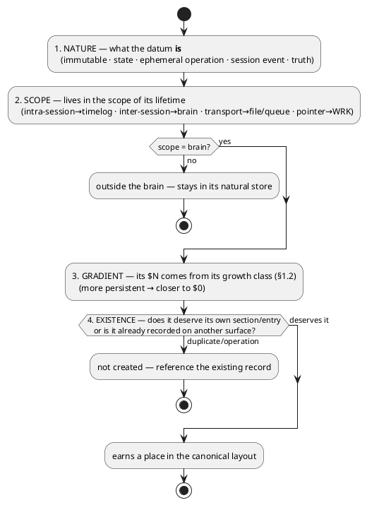

<!-- DOC-BRAND -->

  <picture>
    <source media="(prefers-color-scheme: dark)" srcset="../../../docs/assets/brand/arqux-logo-primary-dark.svg">
    
  </picture>

Canon · Normative · ArqUX 1.0.0

<!-- /DOC-BRAND -->

# Section Canon — `brain.cortex` (Level 3 / BRAIN)

*English translation — canonical source: `docs/es/especificacion/cerebro-canon.md`*

**Status:** current canon (ALFRED · CYCLE-16 · 2026-11-15, rev. GRADIENT-12)
**Folder:** `docs/es/especificacion/` — index in `README.md`.
**Scope:** project `brain.cortex` and workspace `meta-brain.cortex`.
Identities (`<agent>.cortex`) and skills have their own canon
(Level 1/2 — see `formato.md` and `artefactos.md`).
**Architect's directive:** the most persistent, lowest-growth
sections sit closest to `$0`; elevation flows toward zero.

---

## 1. The canon's axis: `$N` = distance to truth

This canon declares a single ordering axis:

> **`$N` grows with volatility and accretion. `$0` is the medium;
> `$1`..$n descend in persistence and importance; the bottom
> accumulates the highest-churn appendix record.**

Direct consequences:

1. **The number DOES carry semantics** — it encodes the section's
   persistence class. It is not "just physical order": it is the
   gradient that makes learning elevation physical (every promotion
   is decreasing `N`).
2. **The title remains the identity** — consumers resolve by title,
   never by hardcoded number. The number can be renumbered in
   migrations; the title cannot.
3. **Numbering is sequential and gapless** from `$0`.
4. **The file reads as the learning funnel**: raw material at the
   bottom (ledger), distillation in the middle (staging), truth on
   top (contract). Reading `$0` to `$N` is reading from the
   permanent to the ephemeral.

### 1.1 Why it converges with reading ergonomics

The persistence gradient and the bootstrap read order are the same
order:

- An agent at bootstrap reads **who → what binds me → what I know →
  what I do → where I left off**: exactly sections `$1`–`$7`, all
  compact.
- **The event wall does not live in the brain**: `AUD`/`DEC` are
  session history and reside in their session's timelog (`$5 EVENTS`,
  see `eventos-timelog.md`). The brain's only ledger (`$10 SESSIONS`)
  is a compact index — one entry per session.
- The durable (`KNOWLEDGE`, `RISKS`) sits in view before volatile
  state — the agent bootstraps with its consolidated truth, not
  after it.
- The glossary opens and the document's identity follows
  immediately: `ARQX:artifact` is the first `$1` entry — the most
  persistent datum at the point closest to zero.

### 1.2 Growth classes (the axis metric)

Position is decided by **growth class**, not by point mutation
frequency:

| Class | Model | Grows? | Examples |
|---|---|---|---|
| `contract` | in-place, nearly immutable | No | IDENTITY, AXIOMS, KNOWLEDGE, RISKS |
| `state` | in-place, rewritten | No (same entry) | FOCUS, OBJECTIVES, ACTIVE_CONTEXT, LOOPS |
| `staging` | append with drainage | Yes, bounded | LESSONS (drains → contract) |
| `ledger` | append-only, bounded | Yes | SESSIONS (index) — events live outside, in timelog |
| `envelope` | structural | No | GLOSSARY (+ `ARQX:artifact` at `$1` head) |

Derived rule: **no `ledger` section may precede a `staging` one,
and no `staging` a `contract`/`state` one.** The funnel is monotonic.

### 1.3 Composition principle — the test every datum must pass

Every "where does this go?" decision — a new datum, a proposed
section, a migration — is resolved by applying this procedure,
**in order**:

Corollaries — structural lessons that produced this canon:

- **A section is a container class, not a per-datum slot.**
  A single record does not deserve a section (`ARQX:artifact` → head
  of `$1`, not `$15`); it deserves the best position the format
  allows.
- **State ≠ operation.** The brain holds state and truth; an
  operation is *audited*, not *remembered* (handoff → event + file +
  pointer; the `HANDOFFS` section empirically stayed empty — it was
  a duplicate ledger of an already-recorded fact).
- **The event belongs to its session.** Writing to a store and then
  inventing a deletion policy (T1 over `PULSE`) is architectural
  debt, not a feature. **Rule: where a retention/pruning policy
  exists, question the store — do not tune the policy.**
- **Bias toward fewer sections.** Every section costs: schema,
  validator, a semantic position to defend. Before "where does this
  go?" comes "does it deserve to exist?". This canon removed **five**
  sections (`ARQUX_METADATA`, `HANDOFFS`, `PULSE`, `CONCURRENCY`,
  `ISSUES`) and every subtraction *added* capability: durable
  evidence, per-file concurrency, zero pruning, zero duplicate
  ledgers.
- **Decomposition before placement.** When a concept does not fit
  cleanly, decompose it (event / payload / pending) and file each
  piece by its nature — never create a section for the
  undifferentiated concept.

---

## 2. Canonical layout

| # | Title | Zone | Sigils | Mutation | Req. | Retention |
|---|---|---|---|---|---|---|
| $0 | `GLOSSARY` (no visible title) | envelope | `SIGIL:name{...}` declarations, `format`, `GTYP`, `GMIC`, `GCON` | structural | Yes | permanent |
| $1 | `IDENTITY` | contract | `IDN`, `ARQX` (with `version`/`revision`/`last_writer`) | in-place | Yes | permanent |
| $2 | `AXIOMS` | contract | `AXM` | in-place | Yes | permanent (mandate) |
| $3 | `KNOWLEDGE` | contract | `KNW`, `REF`, `DEP`, `DESC` | in-place | Opt. | permanent (curated) |
| $4 | `RISKS` | contract | `RSK`, `LIM`, `CNST`, `PFL` | in-place | Opt. | permanent |
| $5 | `FOCUS` | state | `FCS` | in-place | Yes | current state |
| $6 | `OBJECTIVES` | state | `OBJ` | in-place | Yes | current state |
| $7 | `ACTIVE_CONTEXT` | state | `WRK`, `STP`, `NXT`, `CTX`, `HND` | in-place | Yes | current state |
| $8 | `LESSONS` | staging | `LNG` | append+drains | Opt. | **with drainage** (aprendizaje.md §3) |
| $9 | `LOOPS` | system | `LOOP` | in-place | Opt. | current state |
| $10 | `SESSIONS` | ledger | `SES` | append | Opt. | session index |

**No events section.** `AUD`/`DEC`/`ERR` are *intra*-session history:
they live in `$5 EVENTS` of the producing session's timelog
(`.arqux/timelog/SESNNN_*.cortex`), not in the brain — see
`eventos-timelog.md`.

**No issues section.** The real store is `.arqux/issues/`; open ones
are derived by `status` — a section would be the second ledger of
the same fact (`HANDOFFS` signature: zero writers, zero historical
entries). If bootstrap needs "what is broken", it is a query or a
pointer in `WRK:current`.

**No concurrency nor metadata section.** `ARQX:artifact` is a single
nearly-immutable record — it does not deserve its own section: it
lives as **first body entry** (`$1 IDENTITY`, before `IDN:governor`)
and carries the document's revision
(`version`/`revision`/`last_writer` — the timelog `TLG:identity`
pattern). Unified rule for every ArqUX artifact: *the document
declares itself at the point closest to zero the format allows*
(`$0` is pure declaration space — G016 requires `type:` on every
glossary symbol — so the first legal data record is the `$1` head).
`$0.1`/`$15`/`$19` remain legacy positions accepted on read, never
emitted by new writers.

Physical order = table order, `$N` gapless and without duplicates.

**Known real drift of the live brain** (old-layout residue — G-4
debt): `$5 FOCUS` carried 5 `DEC` + ~6 dragged `LNG`; `$3 KNOWLEDGE`
hosted a `SES:revision_0_9_0rc1_cierre` squatter; `$10` = 23 entries
(21 sessions + 2 ghost `SES:<agent>` `status:"active"` from
`sessions.py`); `$8` = ~226 `LNG` of which **183 had `________*`
placeholder names and 22 were `session_*` boilerplate** — the "queue"
operated as a store (G-5 debt). And the brain's own `$0` **carried no
executable declarations** (only `$0`+`$0:format`) — violating rule 8;
all repaired in CYCLE-16.

---

## 3. Sections in detail

### $0 GLOSSARY — the medium (envelope)

Only structural content. FORBIDDEN to hold operative memory (E033).
Living here: `$0:format{cortex:1.0, encoding:UTF-8}`, executable
declarations `SIGIL:name{type, weight, focus, fields, desc, open}`,
types (`GTYP`), micro-glossary (`GMIC`) and constants (`GCON`).

- **Readers:** parser, validator, writer.
- **Writers:** writer (auto-declares emitted sigils), migrator.
- **Rule:** every new write declares — `$0:format` + executable
  declarations mandatory.

### $1 IDENTITY — who this brain is (contract)

`ARQX:artifact{level:3, name, usage, kind, version, revision, last_writer}`
as **first entry** — the *document*'s identity, including its
revision (the timelog `TLG:identity` pattern: `version`/`revision`
in the identity itself) — followed by `IDN:governor` (mandatory in
project brain) — the *agent/project* identity. Same pattern as
identity files (`<agent>.cortex`): the document declares itself
before declaring its content.

- **Readers:** bootstrap, `identity.*`, verify, `project.status`.
- **Writers:** `project.init`, `protocol.*`.
- **Growth:** nil — 2-3 entries, rewritten at most.

### $2 AXIOMS — the project's constitution (contract)

**Project** behavioral axioms: non-negotiable rules imposed by the
Architect or **elevated by forced learning** (repeated correction →
`AXM`). `survive:min` or `severity:blocking` recommended so brain
mutability does not degrade them.

- Distinct from `AGENTS.md` (transversal framework axioms, kernel)
  and identity axioms (agent contract): these are the **project's**
  constitution — what makes each brain unique.
- **Readers:** every agent at bootstrap — read before state.
- **Writers:** Architect mandate, engine forced elevation.
- **Growth:** nil by design — every axiom weighs a decision.

### $3 KNOWLEDGE — durable operational truth (contract)

Consolidated project knowledge: verified patterns, technical
decisions, promoted lessons. It is the funnel's **first elevation
stop** (`LNG` → `KNW`).

- Sigils: `KNW` (durable fact), `REF` (reference), `DEP`
  (dependency), `DESC` (descriptor).
- **Readers:** context bootstrap, `cortex.knowledge`, planning.
- **Writers:** `cortex.learn.elevate` (with confirmation), the
  Architect.
- **Growth:** slow and curated — every entry is a truth, not an
  event. If it grows fast, something is escaping the filter.

### $4 RISKS — the domain's limits (contract)

`RSK` (risks), `LIM` (hard limits), `CNST` (constraints), `PFL`
(pitfalls). Knowledge about what can harm — adjacent to `KNOWLEDGE`
by nature (it is truth about boundaries).

- **Readers:** verify, planning, audit.
- **Growth:** nil-slow; stable entries.

### $5 FOCUS — what now (state)

`FCS` — the current work focus. Level-3 rule (E024/E034): ≥1 `FCS`
with `status∈{current,blocked}` and non-empty `what`. `status:done`
does not count as active.

- **Mutation:** in-place — the focus is rewritten, focus history is
  not accumulated (that is PULSE/SESSIONS).
- **Readers:** bootstrap dashboard, verify E024.

### $6 OBJECTIVES — toward where (state)

`OBJ` — active objectives. Same Level-3 rule: ≥1 `OBJ` with
`status∈{current,blocked}` and non-empty `goal`.

- **Mutation:** in-place or directed replacement; fulfilled
  objectives change status, they are not collected here.

### $7 ACTIVE_CONTEXT — working memory (state)

`WRK:current` is the **single source of truth** of the agent's
working state (bootstrap reads it first after the contract).
`STP`/`NXT` carry next steps; `CTX` active context. `HND:<to>`
carries a pending handoff's payload (state, not operation — see
HANDOFFS note in `$10`).

- **Mutation (canon):** maximum frequency, **zero growth** — each
  checkpoint rewrites `WRK:current` in-place. Expected 1-3 entries +
  the 5 residual G-8b `HND`s; if it accumulates, the writer is
  failing.
- **Orphan residue**: the 5 `HND:*` migrated in G-8b were
  consumer-less residue — `session.handoff` already writes `HND:<to>`
  in this section by title (CYCLE-16) and `handoffs/` is not
  recreated. The migrated `HND`s drain when their handoff is claimed
  or expires.
- **Positional collisions** (closed in CYCLE-16): `pulse.py` routes
  `AUD` to timelog `$5 EVENTS` with *title-based* PULSE fallback;
  `cortex.checkpoint` writes `WRK:current` resolving `ACTIVE_CONTEXT`
  by title (`$7` fallback, no ghost section); `sessions.py` resolves
  `SESSIONS`/`ACTIVE_CONTEXT`/`$1 ARQX` by title — the positional
  `$5`/`$6`/`$12` writers were retired.
- **Position:** last of the `state` zone — the most volatile state
  before the queues.

### $8 LESSONS — the funnel's hinge (staging)

**The workspace's only lesson surface** (Architect rule
2026-11-15): every capture — `identity.record` (any kind),
consolidations (`cycle.close`, `pulse.*`) — writes `LNG` here, with
`type/cause/lesson/prevention/agent`.

- **Position:** the only `staging` section, immediately after state —
  it is the hinge between the sources below and the contract above.
- **Drainage (mandatory):** `$8` is a **queue, not a store**.
  Lessons drain toward: `$3 KNW` (operational knowledge,
  `cortex.learn.elevate`), `$2 AXM` (forced learning), or
  `<agent>.cortex` `AXM`/`LIM` (behavioral, `identity.elevate`). A
  lesson that does not drain within its review horizon is debt.
- `.lessons.cortex` and identities' `BEHAVIORAL LESSONS` are
  deprecated as stores — identity only carries elevated contracts.
- **Retention:** drainage policy defined in aprendizaje.md §3
  (documented evolution — analogous to PULSE's T1).

### $9 LOOPS — registered autonomy (system)

`LOOP:<name>{state,index,phases,recurrence,max_stall}` declarations
of autonomous loops — living cross-session entities (config +
in-place state). The `autonomia` skill governs them; the execution
trail lives in the timelog.

> **Note — why `ISSUES` does not exist:** the real store is
> `.arqux/issues/` (one file per issue) and open ones derive by
> `status` — zero writers, zero historical entries: `HANDOFFS`
> signature. An open issue IS inter-session state, but it is answered
> with a query or a `WRK` pointer, not a second ledger.

> **Note — why `CONCURRENCY` does not exist:** its only entry was
> `ERR:concurrency{version,last_writer}` — neither concurrency nor
> errors, but **document revision**: metadata now living in
> `ARQX:artifact` (`$1`). Errors as events live in timelog
> `$5 EVENTS`.

### $10 SESSIONS — session record (ledger)

`SES` — one entry per session (compact record; detailed
traceability lives in `.arqux/timelog/`). Append-only, moderate
growth. It is the **primary signal source** for the learning
engine.

> **Note — why `HANDOFFS` does not exist:** a handoff is an
> *operation*, not a state. It decomposes into event (→ emitter's
> timelog `$5 EVENTS`), payload (→ `HND:<to>` in `$7` — the
> `handoffs/` directory was removed in G-8b; the queue-file was a
> second messenger of the same state) and pending (derivable from
> the `HND` entry's presence). The section empirically stayed empty.

> **Note — why `PULSE` does not exist:** an event is *intra*-session
> history, not project state. It was the brain's highest-churn
> section (276 archived entries) and required a retention window
> (T1) to get rid of what it wrote — proof it never belonged here.
> Under this canon events live in `$5 EVENTS` of their session's
> timelog (`eventos-timelog.md`): append-only, **never pruned**,
> with full context. The brain keeps only the `SES` index.

---

## 4. Ordering and writing rules

1. **Strict ordinal** — sections are emitted in table order; `$N`
   gapless and without duplicates.
2. **Monotonic zones** — `contract` < `state` < `staging` < `system` <
   `ledger`. `$0` opens the envelope and `$1` carries the document's
   identity; no colophon section exists. A new section is placed by
   its growth class, not numbering convenience.
3. **Exact canonical title** — uppercase; underscore only where the
   table indicates (`ACTIVE_CONTEXT`). The `brain_structure`
   validator compares id↔title against this table (GRADIENT-12,
   `constants.py` `BRAIN_SECTION_TITLES`) since CYCLE-16 — a legacy
   `$0`–`$15` brain reports `E027_MALFORMED_SECTION` by position, as
   expected.
4. **Absent optional sections** — omitting an empty optional is
   allowed; warning, not error.
5. **Extensions** — a new section enters as `$11+` with its own
   title and MUST be registered here (with its zone) before
   production use.
6. **Title resolution** — every new consumer resolves by title
   (`learning/sections.py` does), never by number.
7. **Bounded growth** — the brain accumulates axioms, knowledge and
   **pointers**, not logs or events. Traceability → SESSIONS;
   events → timelog `$5 EVENTS` (see `eventos-timelog.md`). LESSONS
   drains. No agent should read ~700KB to bootstrap.
8. **Every new write declares** — `$0:format` + executable
   declarations of emitted sigils + `ARQX:artifact` as first body
   entry. The writer generates them automatically; hand-rolled
   writers must replicate them.

---

## 5. Sigil → section map (learning engine)

| Sigil | Section | Title | Zone |
|---|---|---|---|
| `IDN` | $1 | IDENTITY | contract |
| `AXM` | $2 | AXIOMS | contract |
| `KNW`, `REF`, `DEP`, `DESC` | $3 | KNOWLEDGE | contract |
| `RSK`, `LIM`, `CNST`, `PFL` | $4 | RISKS | contract |
| `FCS` | $5 | FOCUS | state |
| `OBJ` | $6 | OBJECTIVES | state |
| `WRK`, `STP`, `NXT`, `CTX`, `HND` | $7 | ACTIVE_CONTEXT | state |
| `LNG` | $8 | LESSONS | staging |
| `LOOP` | $9 | LOOPS | system |
| `SES` | $10 | SESSIONS | ledger |
| `AUD`, `DEC`, `ERR` | — | **timelog `$5 EVENTS`** | intra-session |
| `ARQX`, `SKL` | $1 | IDENTITY (first entry) | contract |

**Forced elevation → AXIOMS:** when learning detects a repeated
correction or a project behavioral rule, it elevates to `AXM` in
`$2` — lessons inform, axioms mandate. It is the funnel's longest
jump (staging → apex) and the scarcest by design.

---

<!-- DOC-FOOT -->

ArqUX 1.0.0 · verified 2026-11-15 · <a href="../../../docs/en/README.md">documentation index</a>

<!-- /DOC-FOOT -->
