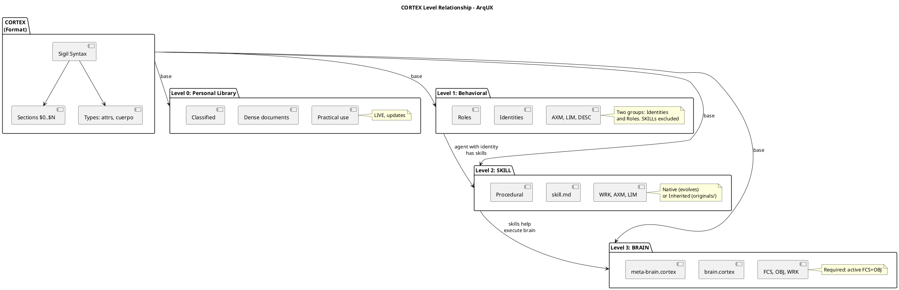
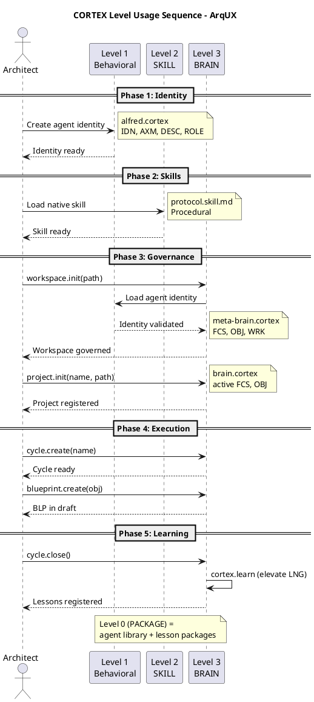

<!-- DOC-BRAND -->
<p align="center">
  <picture>
    <source media="(prefers-color-scheme: dark)" srcset="../../../docs/assets/brand/arqux-logo-primary-dark.svg">
    
  </picture>
</p>
<p align="center"><sub>Canon · Normative · ArqUX 1.0.0</sub></p>
<!-- /DOC-BRAND -->

# CORTEX Document Levels — ArqUX Framework

*English translation — canonical source: `docs/es/especificacion/niveles-cortex-arqux.md`*

> Complete reference of CORTEX file levels: what they are, how they are inferred, what they validate.
> Format: HCORTEX-READ | Profile: FULL | Version: 3.0

---

### CORTEX Levels — Quick View

| Level | Name | Question | Type | Update |
|-------|------|----------|------|--------|
| **0** | PACKAGE | What do I have? | Personal Library | Frequent (learning) |
| **1** | BEHAVIORAL | Who am I? | Identity | Only by elevation |
| **2** | SKILL | What can I do? | Procedural | By design/evolution |
| **3** | BRAIN | What am I doing? | State | Continuous (real time) |

---

## §1: What is a Level?

CORTEX defines a universal **syntax** of sigils, sections and types.
ArqUX defines **governance rules** over that syntax via **levels**.

Every `.cortex` file has a level that determines:
- Which sigils are permitted or forbidden
- Which fields are mandatory
- Which validation errors apply on write

| Aspect | CORTEX (format) | ArqUX (framework) |
|---|---|---|
| Syntax | Sigils, sections $0-$N | — |
| Types | attrs, cuerpo, attrs-pos | — |
| Levels | — | Level 0, 1, 2, 3 |
| Validations | Lexical parsing | E023, E024, E029 |
| Rules | Local schema | survive, blocking, live state |

**Principle:** CORTEX is the metalanguage. The levels are ArqUX using CORTEX as substrate.

---

## §2: Level 0 — Agent's Personal Library

**Type:** `personal-library`
**Files:** Dense, classified documents of practical use for the agent.

| Property | Value |
|---|---|
| Forbidden sigils | None |
| Required sigils | None |
| Restrictions | Only the common rules (§7) |
| Nature | **LIVE** — updated over time as management and governance require |
| Scope | Global (workspace) or particular (project) |
| Creator | Architect (requests) or Agent (when a learning pattern requires it) |
| Main reader | The agent |
| Inference | Default when no IDN, filename or sigils exist |

### Purpose

The agent's personal library: dense, classified texts of practical use for easy retrieval during routine work. They are LIVE documents that can be updated over time as management and governance require.

### Typical Use

- Usage patterns the agent repeats
- Learned shortcuts and procedures
- Important contexts for easy access
- Lessons not yet elevated to a higher level
- Practical information for daily routines

### Characteristics

| Characteristic | Description |
|---|---|
| Classification | Organized by topic or context |
| Density | Concise, direct information |
| Accessibility | Easy retrieval during work |
| Evolution | Updated as governance changes |
| Location | Global workspace context or particular project |

---

## §3: Level 1 — Behavioral

**Type:** `behavioral`
**Purpose:** Defines the dimensions of behavior the agent may and must have.

### Two Fundamental Groups

#### Group 1: Identities

The identity the agent may assume. Includes:

| Dimension | Description |
|---|---|
| Behavioral orientation | Initial form of behavior |
| Action principles | Values and norms guiding behavior |
| Communication | Style and manner of interaction |
| Specialization | Area of focus or domain |
| Vocational orientation | Purpose or professional calling |
| Self-discipline | Self-control and constancy |

**Main virtue:** Establishes a clear interaction nexus between agent and user, facilitating communication depending on their directives, values and norms.

#### Group 2: Roles

The attributions and limitations conferred on an identity at a given moment.

**Example:**
- Alfred as **governor** → has specific attributions and restrictions
- Alfred as **executor** → has different attributions and restrictions

**Important:** The same identity may assume different roles. Governor Alfred is not the same as executor Alfred. This allows executing the same action with different personalities (Jarvis, Heimdall), producing different results due to their distinct values and disciplines.

### Fundamental Rule

**SKILLs** are not a direct part of this level — they are **procedural**, not behavioral.

### Level 1 Files

| Type | Files | Example |
|---|---|---|
| Identity | `<agent>.cortex` | `alfred.cortex`, `jarvis.cortex` |
| Role | Defined in the identity or separately | `governor.cortex`, `executor.cortex` |

### Identity Learning System

> **Architect's rule (2026-11-15):** lessons live ONLY in
> `brain.cortex` `$8` (LNG). From there they may elevate to two
> destinations:
>
> - **`$11` KNOWLEDGE (KNW)** — project operational knowledge, inside
>   the brain (`cortex.learn.elevate`).
> - **`<agent>.cortex` `AXM`/`LIM`** — behavioral knowledge, inside
>   the identity contract (`identity.elevate` →
>   `IdentityManager.elevate_to_identity`).
>
> `.lessons.cortex` (Level 0) and identities' `BEHAVIORAL LESSONS`
> section are **deprecated as lesson stores** — identity carries only
> elevated contracts (AXM/LIM), never raw captures.

**Learning Flow:**

```
Capture (single surface)              Elevation (two destinations, governed)

brain.cortex $8 LNG ──┬──▶ brain $11 KNW          (operative: cortex.learn.elevate)
                      └──▶ <agent>.cortex AXM/LIM  (behavioral: identity.elevate)

   type/cause/lesson/prevention/agent   dry-run → preview_hash → confirm → verify
```

**Fundamental Rule:** Personality does NOT change directly. No
capture handler writes to the identity contract — only governed
elevation mutates `<agent>.cortex`, with dry-run, confirmation hash
and atomic post-write verification (`silent_corruption` axiom).

**Capture:** `identity.record` (all kinds) and any consolidation
path (cycle.close, pulse sweeps) write `LNG` to the project brain's
`$8`. The LNG's `agent` field preserves originator attribution —
needed to decide which contract a behavioral lesson elevates to.

**Behavioral elevation (`identity.elevate`, MCP):** reads the LNG
from the brain, proposes `AXM` (contract_type=AXIOM) or `LIM`
(LIMIT), writes via `IdentityManager.elevate_to_identity` — the only
sanctioned identity-mutation path (atomic write with `.bak`,
canonical escaping, dedup by `(sigil, name)`, post-write
verification with rollback). Permission: `CONDITIONAL_MUTATING` —
auditor previews only; governor/executor apply.

### Typical Sigils

| Sigil | Use |
|---|---|
| IDN | Agent identity (name, role, purpose) |
| AXM | Behavioral axioms |
| LIM | Operative limits |
| DESC | Textual description of the identity |
| ROLE | Role definition (attributions and limitations) |

### Example

```cortex
$1: IDENTITY

IDN:alfred{name:"Alfred", role:"assistant", kind:"behavioral",
  purpose:"Asistente personal del Arquitecto", version:"2.0.0"}

$2: BEHAVIORAL DIMENSIONS

AXM:workflow_fidelity{ Respeto irrestricto a los workflows
de gobierno. Cada paso se ejecuta en el orden definido. }

$3: ROLES

ROLE:governor{attributions:"crear BLPs, asignar ejecutores, verificar ACs",
  restrictions:"no ejecutar tareas directamente", status:"current"}

ROLE:executor{attributions:"ejecutar tareas, reportar progreso",
  restrictions:"no modificar governance files", status:"current"}

$4: AXIOMS

AXM:workflow_fidelity{ Respeto irrestricto a los workflows
de gobierno. Cada paso se ejecuta en el orden definido. }
```

---

## §4: Level 2 — SKILL

**Type:** `procedural`
**Purpose:** Capabilities an agent can incorporate directly into its work — the "how to do it" in a simple, efficient, orderly and methodologically acceptable way.

### Definition

SKILLs are an **industry standard** for sharing specialization for agents on specialized tasks/activities. They are ultra-specialized reference books.

### Format

| Property | Description |
|---|---|
| Physical format | `.md` (markdown) |
| Internal content | codec-cortex |
| Purpose | Enable universal adoption (agents + technologies) |

### Two Kinds of SKILLs

| Type | Origin | Modifiable | Evolution |
|------|--------|------------|-----------|
| **Native** | Built in ArqUX | YES | Adapts to our needs |
| **Inherited** | Third parties / Industry | NO | Used as-is (format converted) |

### Inherited SKILL Adoption Flow

```
Inherited SKILL (third parties)
         ↓
skills/originals/   ← native MD (NOT used directly)
         ↓
Conversion to CORTEX format
         ↓
skills/             ← cortex.md ready to use
         ↓
Internal flag: inherited/foreign/proprietary
```

### Directory Structure

```
.arqux/skills/
├── protocol.skill.md      ← Native (evolves)
├── cortex.skill.md        ← Native (evolves)
├── mcp-handlers.skill.md  ← Inherited (converted)
└── originals/
    └── mcp-handlers.md    ← Original MD (reference)
```

### Inheritance Flag

```cortex
SKILL:mcp_handlers{source:"third-party",
  origin:"opencode",
  kind:"inherited",
  adapted:"2025-07-10"}
```

### Current State

All existing SKILLs in ArqUX are **native** and evolve with the project. The `originals/` directory will be used when third-party skills are incorporated.

### Rules

| Rule | Description |
|------|-------------|
| Native | They evolve, adapt, refine |
| Inherited | Preserved in `originals/`, converted to CORTEX |
| Noise | Avoid introducing non-specialized content |
| Ultra-specialized | Each SKILL = one specific capability |

### Typical Sigils

| Sigil | Use |
|---|---|
| WRK | Procedures and workflows |
| AXM | Procedural axioms |
| LIM | Capability limits |
| STP | Execution steps |

### Example

```cortex
$1: PROTOCOL

WRK:session_start{
  1:"Leer brain.cortex",
  2:"Presentar dashboard",
  3:"Preguntar objetivo"}

$2: DECISION FRAMEWORK

AXM:mode_aware{
  design:"documentar sin ejecutar",
  exec:"ejecutar con checkpoints",
  review:"verificar ACs"}
```

---

## §5: Level 3 — BRAIN

**Type:** `brain`
**Files:** `brain.cortex`, `meta-brain.cortex`.

### Definition

The Brain is the **project's live state** — it captures what the agent is doing right now: active cycle, running blueprints, focus and current progress.

### Fundamental Rule

A brain MUST have at least one active **FCS** and one active **OBJ** at all times.
Without active focus and objective, the brain is semantically invalid.

### Mandatory Fields

| Entry | Required fields | Notes |
|---|---|---|
| FCS | `what` (non-empty), `status` (current/blocked), `survive` | `status:done` does NOT count as active |
| OBJ | `goal` (non-empty), `status` (current/blocked), `survive` | `status:done` does NOT count as active |
| WRK | `current` (non-empty), `blocked` (no), `survive` | Current execution state |

### Associated Errors

| Code | Condition | Severity |
|---|---|---|
| E024_LEVEL2_MISSING_FOCUS | No active FCS with non-empty `what` | Non-bypassable error |
| E024_LEVEL2_MISSING_FOCUS | No active OBJ with non-empty `goal` | Non-bypassable error |
| E034_CRITICAL_REQUIRED_FIELD_EMPTY | Required field exists but is empty ("", "null", "tbd") | Non-bypassable error |
| E032_CRITICAL_SIGIL_INCOMPLETE | A required field is missing entirely | Non-bypassable error |

### Closed-State Rule

`status: "done"` is a closed state, NOT an active state.
A brain with FCS `status:done` does NOT satisfy Level 3.

### Canonical Brain Structure

> **Current canon:** `docs/es/especificacion/secciones-cerebro-canon.md`
> ($0–$15, includes `AXIOMS` in `$2` — each brain's own behavioral
> axioms, imposed by the project or elevated by forced learning).
> The table below reflects that canon — **note it documents the
> historical $0–$15 layout; the current GRADIENT-12 canon lives in
> `cerebro-canon.md`.**

| Section | Content | Required |
|---|---|---|
| $0 | Local sigil glossary | Yes |
| $1 | IDENTITY — governor, project | Yes |
| $2 | AXIOMS — project behavioral axioms | Yes |
| $3 | FOCUS — active FCS | Yes |
| $4 | OBJECTIVES — active OBJ | Yes |
| $5 | SESSIONS — session history | Optional |
| $6 | HANDOFFS — agent handoffs | Optional |
| $7 | PULSE — event audit (bounded) | Yes |
| $8 | LESSONS — learned lessons | Optional |
| $9 | ACTIVE_CONTEXT — current WRK | Yes |
| $10 | RISKS — risks, limits and constraints | Optional |
| $11 | KNOWLEDGE — stable knowledge | Optional |
| $12 | CONCURRENCY — version control | Yes |
| $13 | ISSUES — incident record | Optional |
| $14 | LOOPS — autonomous loops | Optional |
| $15 | ARQUX_METADATA — artifact metadata | Yes |

### Example

```cortex
$3: FOCUS

FCS:current{what:"Implementar validación de duplicados",
  priority:"medium", status:"current", survive:"work"}

$4: OBJECTIVES

OBJ:_1{goal:"Completar BLP-003 con auto-numeración",
  status:"current", success:"E3 resuelto", survive:"work"}
```

---

## §6: Level Inference

The level is determined automatically by 4 rules in precedence order:

| Priority | Method | How determined |
|---|---|---|
| 1 | `kind` attribute in IDN | `IDN:agent{kind:"behavioral"}` → Level 1 |
| 2 | File name | `brain.cortex` → Level 3, `<agent>.cortex` → Level 1 |
| 3 | Sigil signature | `WRK`+`FCS` present → Level 3 (brain) |
| 4 | Default | Unclassified → Level 0 (package) |

### Sigil Signature Rule

| Sigil combination | Inferred level |
|---|---|
| `WRK` + `FCS` present | Level 3 (brain) |
| `IDN` + `AXM` present, `WRK` absent | Level 1 (behavioral) |
| Procedural (WRK without FCS) | Level 2 (skill) |
| No combination | Level 0 (package) |

---

## §7: Rules Common to All Levels

### survive — Retention Policy

| Value | Meaning | Priority |
|---|---|---|
| `min` | Minimum retention — survives only explicit deletion | P0 (critical) |
| `recovery` | Recovery-mode retention | P1 |
| `work` | Normal work retention | P2 (default) |
| `full` | Complete retention | P3+ |

**Validation:** `survive` only accepts the values above.
Any other value produces `E025_INVALID_SURVIVE`.

### severity:blocking — Independent Protection

A `CNST` with `severity:blocking` is protected independently of `survive`.
Retention and protection are **orthogonal**.

### attrs-pos — Positional Arity

`attrs-pos` sigils must have exactly the number of positional values their contract declares in $0.
Excess values are silently discarded with `E027_ATTRS_POS_ARITY`.

### Secrets — Absolute Prohibition

No CORTEX file may contain plaintext secrets:

- API keys, tokens, passwords
- URLs with embedded credentials
- Private keys

This applies at ALL levels without exception and is not bypassable.

---

## §8: Summary Table

| Level | Name | Type | Files | Live state | Key error |
|---|---|---|---|---|---|
| 0 | PACKAGE | Personal Library | Dense documents (`<agent>.lessons.cortex` **deprecated** 2026-11-15 — lessons only in brain `$8`) | **LIVE** (updates) | — |
| 1 | BEHAVIORAL | Identity | `<agent>.cortex` | FORBIDDEN (elevation only) | E023_LEVEL1_LIVE_STATE |
| 2 | SKILL | Procedural | `.md` with cortex content | By design/evolution | — |
| 3 | BRAIN | State | `brain.cortex`, `meta-brain.cortex` | REQUIRED (FCS+OBJ) | E024_LEVEL3_MISSING_FOCUS |

---

## §9: Diagrams

### Level Relationship Diagram



### Usage Sequence Diagram



---

> HCORTEX-READ document.
> Version: 3.0 — 2026-07-10.
> Belongs to the ArqUX framework, not CODEC-CORTEX.

<!-- DOC-FOOT -->
<hr>
<p align="center"><sub>ArqUX 1.0.0 · verified 2026-11-15 · <a href="../../../docs/en/README.md">documentation index</a></sub></p>
<!-- /DOC-FOOT -->
