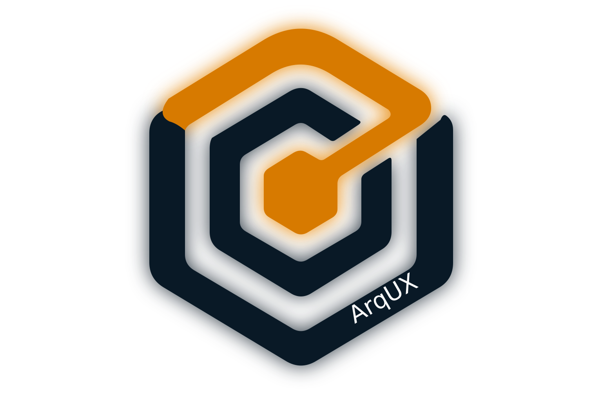

<!-- DOC-BRAND -->

  <picture>
    <source media="(prefers-color-scheme: dark)" srcset="../../../docs/assets/brand/arqux-logo-primary-dark.svg">
    
  </picture>

Referencia · Normativo · ArqUX 1.0.0

<!-- /DOC-BRAND -->

# Catálogo del contrato de fallos

Todo código de resultado que ArqUX 1.0.0 puede emitir — significado, causa típica, recuperación accionable y test que lo cubre. Extraído del código fuente (`src/arqux/`); ningún código fue inventado. Si el código emite un resultado que aquí no aparece, este documento está desactualizado — repórtelo.

## Convenciones de salida

| Canal | Forma | Cuándo |
|---|---|---|
| `OUT-ERROR code=<CÓDIGO> reason=<texto>` | CORTEX-OUT | Handler rechaza la invocación — exit 1 vía CLI |
| `OUT-WORK` | CORTEX-OUT | Operación aplicada — exit 0 |
| `Exit codes` | entero | `0` éxito · `1` fallo funcional · `2` error de uso (parser click) |
| Excepción Python | `TamperError`, `PermissionDenied`, … | Superficie de librería — el CLI la traduce a `OUT-ERROR`/exit≠0 |

Regla práctica: un `exit 1` con `ERR_*`/`OUT-ERROR` es rechazo del producto (leer causa); un `exit 2` es error de invocación (revisar flags con `--help`).

## Acceso e identidad

| Código | Capa | Significado | Causa típica | Recuperación | Evidencia |
|---|---|---|---|---|---|
| `PERMISSION_DENIED` | MCP/CLI | El rol activo no puede invocar ese handler | Auditor invoca handler mutante; rol sin privilegio | Exportar `ARQUX_AGENT_ROLE` correcto o pedir al governor la operación. En modo legacy (sin `ARQUX_STRICT_ROLES=1`) el chequeo es laxo — no usar laxo para esquivar una denegación | `tests/test_auditor_readonly.py` |
| `PermissionDenied` | librería | Excepción base — el servidor la traduce a `PERMISSION_DENIED` | Misma situación en uso programático | Capturarla y tratar como 403 | `src/arqux/permissions.py` |
| `IdentityVerificationError` | librería | Firma HMAC inválida o replay fuera de ventana | Secreto incorrecto, `agent_id` no coincide, skew > 300 s | Verificar `ARQUX_AGENT_ID`, que `.arqux/secrets/<agent>.key` existe (0600) y que el reloj está sincronizado | `src/arqux/security.py`, `tests/test_security_hmac.py` |
| `SESSION_UNBOUND` | handler | Operación exige sesión ligada y no la hay | `context_set` sin sesión abierta o sesión cerrada | Abrir sesión con `session.context.set` antes de operar | handlers de sesión |

## Formato e integridad

| Código | Capa | Significado | Causa típica | Recuperación | Evidencia |
|---|---|---|---|---|---|
| `TamperError` | librería/CLI | El sello SHA-256 del `.cortex` no coincide con su contenido | Edición manual fuera de handlers, corrupción de disco | **No recomputar el sello a mano.** Restaurar desde `.bak`/`backup` o re-escribir vía handler; investigar quién tocó el archivo | `tests/test_security_cortex.py` |
| `ERR_HASH_MISMATCH` | CLI | `seal.cortex`: artefacto difiere del hash registrado al cierre | Artefacto de ciclo modificado post-cierre | Comparar `recorded` vs `actual`; restaurar el artefacto del backup | `tests/test_req_m1.py` |
| `NOT_FOUND` | handler | Recurso inexistente (proyecto, ciclo, blueprint, entrada) | ID mal escrito, path equivocado, recurso no creado | Listar primero (`*.list`) y verificar `path` apunta al proyecto correcto | `src/arqux/server.py` (wrapper genérico) |
| `ERR_MISSING_ENFORCE` / `ERR_MISSING_ENFORCE_LEVEL` / `ERR_INVALID_ENFORCE` / `ERR_INVALID_ENFORCE_LEVEL` | policy engine | Regla de política malformada o nivel enforce ausente | Regla `RUL:` sin campo obligatorio o valor fuera del set | Corregir la regla en el delta; `validate_policy_file` la diagnostica antes de aplicar | `src/arqux/core/policy_engine.py` |

## Sincronía

| Código | Capa | Significado | Causa típica | Recuperación | Evidencia |
|---|---|---|---|---|---|
| `ERR_CONFLICT_VERSION` | CLI/journal | `push-delta` con `base_version` obsoleta | Otro clone aplicó un delta primero | `arqux pull-policy` → reconstruir el delta sobre la versión vigente → reintentar con `--base` nuevo. Es triaje humano por diseño: nunca se sobrescribe | `tests/test_req_m3.py` |
| `ERR_EMPTY_DELTA` | journal | El delta no contiene reglas aplicables | Archivo delta vacío o sin entradas `RUL:`/`POL:` | Revisar el `.cortex` del delta — debe declarar reglas en su sección | `tests/test_req_m3.py` |
| `DRIFT_DETECTED` | CLI | Proyección editada a mano (AGENTS/CLAUDE/GEMINI/.opencode) | Edición directa de un archivo generado | `arqux sync-harnesses` regenera — la regla de oro es *regenerar, no editar* | `tests/test_req_m2.py` |
| `TimeoutError` | librería | `file_lock` no adquirido en 10 s | Proceso hermano retiene el lock, o lock huérfano | Reintentar; si persiste, revisar procesos con el `.lock` sidecar abierto | `src/arqux/concurrency.py` |

## Evidencia y firma

| Código | Capa | Significado | Causa típica | Recuperación | Evidencia |
|---|---|---|---|---|---|
| `EXPORT_BLOCKED` | CLI | Export con campos `visibility:"private"` sin flag explícito | Timelogs contienen entradas privadas | Decisión humana: `--redact-private` (excluir, conteo registrado) o `--allow-raw` (incluir, `raw:true`). Sin flag no hay export — *fail-closed* | `tests/test_req_m3.py::test_export_blocked_without_flags` |
| `SIGNATURE_VALID` | CLI | Firma Ed25519 verificada — **éxito, no error** | `policy verify` exitoso | — | `tests/test_req_m3.py` |
| `ERR_INVALID_SIGNATURE` | CLI | El documento fue alterado o firmado por otra clave | Tamper post-firma, clave equivocada | Comparar `key_id` del SIG con la clave usada; obtener el documento íntegro de nuevo | `tests/test_req_m3.py` |
| `ERR_NO_SIGNATURE` | librería | El documento no contiene `SIG:signature` | `verify` sobre doc no firmado | Firmar primero (`policy sign`) o verificar el archivo correcto | `src/arqux/signing.py` |
| `ERR_KEY_MISMATCH` | librería | La pública ofrecida no corresponde al `key_id` firmante | `--key` apunta a otro keypair | Usar el keypair cuyo `public:` coincide con el `key_id:` del `SIG:signature` | `src/arqux/signing.py` |
| `ERR_KEY_NOT_FOUND` | librería | Sin `--key` y sin `public:` resoluble en `.arqux/keys/` | Auditor sin clave pública | Colocar el archivo `public:` del emisor bajo `.arqux/keys/` junto al documento | `src/arqux/signing.py` |
| `POLICY_BLOCK` | policy engine | Regla enforce denegó la mutación | Hook evaluate con `action:"deny"` (p.ej. `secret_pattern`) | Leer la regla que bloqueó (`pull-policy`); corregir el contenido, no la regla | `src/arqux/core/policy_engine.py` |

## Plataforma

| Código | Capa | Significado | Causa típica | Recuperación | Evidencia |
|---|---|---|---|---|---|
| `MISSING_DEPENDENCY` | handler cortex | Dependencia requerida ausente | codec o módulo no instalado en el entorno | `uv sync` / reinstalar el extra correspondiente | `src/arqux/handlers/cortex/read_write.py` |
| `ENGINE_UNAVAILABLE` | handler learning | Motor de aprendizaje no disponible | Dependencia del motor ausente | Reinstalar `codec-cortex`/entorno del proyecto | `src/arqux/handlers/cortex/learning.py` |
| `exit 2` | parser click | Error de uso: flag inexistente, arg faltante | `--key` omitido, comando mal escrito | `<cmd> --help` — la referencia `cli.md` lista cada flag | convención click |

## Rechazos genéricos del servidor MCP

Todo handler rechaza con `OUT-ERROR code=<CÓDIGO>`; además de los códigos de dominio anteriores, el wrapper emite:

| Código | Significado | Causa típica | Recuperación | Evidencia |
|---|---|---|---|---|
| `INVALID_ARGS` | Argumentos de la invocación no satisfacen el esquema del handler | Campo requerido omitido (`task_id`), tipo erróneo | Consultar `handler.list`/`describe` del handler — los campos requeridos figuran en su esquema | `src/arqux/server.py` |
| `INTERNAL` / `INTERNAL_ERROR` | Excepción no controlada dentro del handler | Defecto del handler o estado inesperado | Reportar como bug con el payload invocante — no reintentar ciegamente | `src/arqux/constants.py` |
| `VALIDATION` | El estado leído no supera validación estructural | `.cortex` con diagnósticos E0xx pendientes | Correr `arqux validate` sobre el artifacto y resolver cada diagnóstico | `src/arqux/server.py` |

## Diagnósticos de validación (`arqux validate` / `cortex.verify`)

`validate` emite diagnósticos por gravedad — modelo explícito en `src/arqux/constants.py`: solo `severity:"error"` invalida el documento (`E0xx`); `W0xx` son advertencias deduplicadas que nunca invalidan; `I0xx` es informativo.

| Código | Severidad | Significado | Recuperación | Evidencia |
|---|---|---|---|---|
| `E024_LEVEL3_MISSING_FOCUS` | error | Brain nivel 3 sin `FCS:` activo | Añadir entrada `FCS:` con status vigente | `constants.py`, `validators/brain_semantics.py` |
| `E026_MISSING_SECTION` | error | Sección canónica del brain ausente | Restaurar la sección faltante (`$0`–`$10` canon GRADIENT-12) | `validators/brain_structure.py` |
| `E027_MALFORMED_SECTION` | error | Título de sección no coincide con el canon (p.ej. `REGISTRY` donde se espera `SESSIONS`) | Renombrar la sección al título canónico de `BRAIN_SECTION_TITLES` | `validators/brain_structure.py` — observado en `arqux validate` real |
| `E028_NO_ACTIVE_OBJECTIVES` | error | Brain sin `OBJ:` en estado vigente | Declarar objetivo activo o archivar el brain | `constants.py` |
| `W001_NO_METADATA` | advertencia | `.cortex` sin `ARQX:artifact` → degrada a NIVEL 0 | Añadir entrada `ARQX:artifact{...}` | `constants.py` |
| `W002_INCOMPLETE_BRAIN` | advertencia | Brain con menos de 8 secciones activas | Completar secciones canónicas o aceptar brain reducido | `validators/brain_structure.py` |
| `W003_LEARNING_DEBT_BEHAVIORAL` | advertencia | Lección conductual expirada | Revalidar o retirar la lección | `constants.py` |
| `W004_STALE_INHERITED_SKILL` | advertencia | Skill heredada desactualizada vs upstream | Re-sincronizar la skill | `constants.py` |
| `W005_MISSING_ORIGINAL_REF` | advertencia | Entrada adaptada sin `original_ref` | Añadir la referencia de origen | `constants.py` |
| `I001_CODEC_BACKEND_INFO` | informativo | Qué backend codec produjo la validación | — | `constants.py` |
| `I002_PLACEHOLDER_VALUE` | informativo | Valores con marcador `<placeholder>` pendientes | Rellenar los valores pendientes | `constants.py` |
| `I003_EMPTY_SECTION` | informativo | Sección declarada con cero entradas | Poblar o retirar la sección | `constants.py` |

### Diagnósticos del codec y política (prefijo `E0xx`/`W0xx`)

El codec CORTEX (`codec-cortex`, dependencia requerida) y los validadores de `core/state` emiten diagnósticos adicionales de formato y gobierno; los más frecuentes en superficie:

| Código | Origen | Significado | Recuperación |
|---|---|---|---|
| `E002_GLOSSARY_NOT_FIRST` | codec | El glosario `$0` no es la primera sección | Reordenar secciones — el glosario es `$0` canónico |
| `E003_UNKNOWN_SIGIL` | codec | Sigil usado no declarado en glosario | Declarar el sigil o corregir el typo |
| `E007_ATTRS_POS_CONTRACT_MISSING` / `E027_ATTRS_POS_ARITY` | codec | Contrato de posición de attrs ausente/aridad inválida | Declarar `fields:` del contrato correctamente |
| `E008_DUPLICATE_ENTRY` | codec | Entrada repetida en sección | Eliminar el duplicado — verificar handlers de escritura |
| `E015_ATOMIC_WRITE_FAILED` | codec | Escritura atómica falló | Reintentar; revisar filesystem/locks |
| `E023_LEVEL1_LIVE_STATE` | ArqUX `core/state` | Estado vivo (WRK/FCS/LNG-runtime) en artefacto de nivel 1 (identidad) — salvo exención curada | Mover el estado vivo a un brain nivel 3 |
| `E025_INVALID_SURVIVE` | ArqUX `core/state` | Campo `survive:` fuera del set permitido | Corregir el valor survive |
| `E031_SECRET_NOT_BYPASSABLE` | política | Intento de bypass de regla de secretos | No es recuperable por diseño — el contenido no puede contener secretos |
| `E032_CRITICAL_SIGIL_INCOMPLETE` / `E033_ZERO_SECTION_MEMORY_ENTRY` / `E034_CRITICAL_REQUIRED_FIELD_EMPTY` | ArqUX `core/state` | Sigil crítico incompleto, memoria con cero secciones, campo requerido vacío | Completar los campos/secciones marcados |

La enumeración canónica vive en el código fuente: `src/arqux/constants.py` (E024–E028, W0xx, I0xx), `src/arqux/validators/` (emisión) y el paquete `codec-cortex` (diagnósticos de formato). `arqux validate` es la superficie donde todos emergen juntos.

## Errores no codificados — honestidad

No todo fallo tiene código simbólico. Excepciones nativas (`FileNotFoundError`, `PermissionError` de OS, `ValueError`) pueden emerger de paths no envueltos — salen como traceback en CLI o `OUT-ERROR` genérico en MCP. Trátelos como bug de superficie: si un error recurrente carece de código, es candidato a formalización, no a silencio.

## Referencias

- `docs/es/referencia/cli.md` — exit codes por comando
- `docs/es/referencia/formatos.md` — artefactos cuya verificación emite estos códigos
- `THREAT_MODEL.md` — modelo de amenazas detrás de los `ERR_*` de seguridad

<!-- DOC-FOOT -->

ArqUX 1.0.0 · verificado 2026-11-15 · <a href="../../../docs/es/README.md">índice de documentación</a>

<!-- /DOC-FOOT -->
